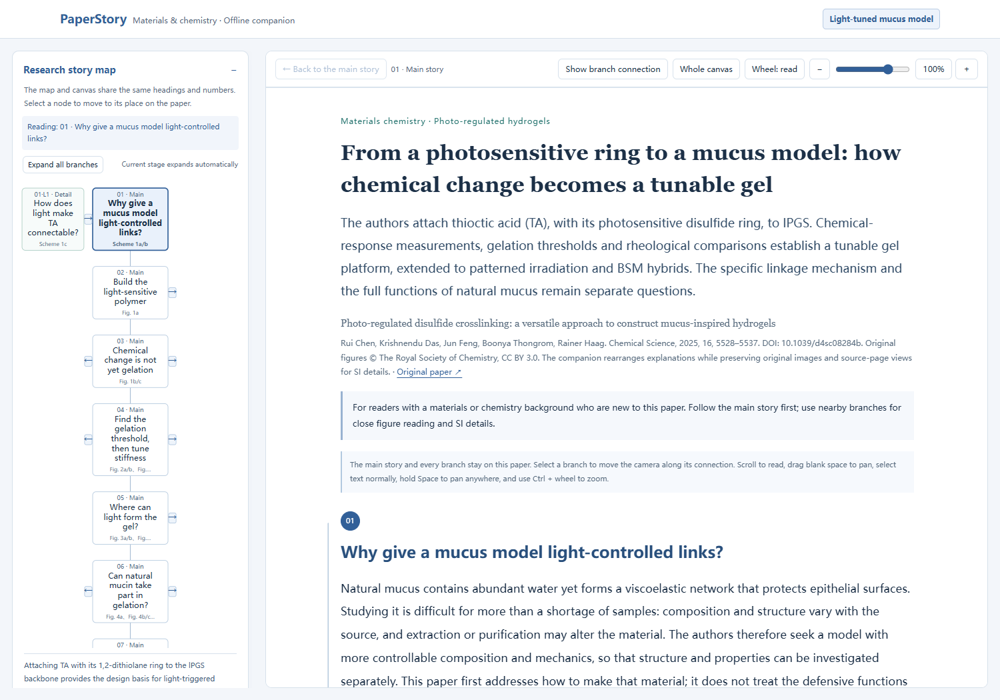
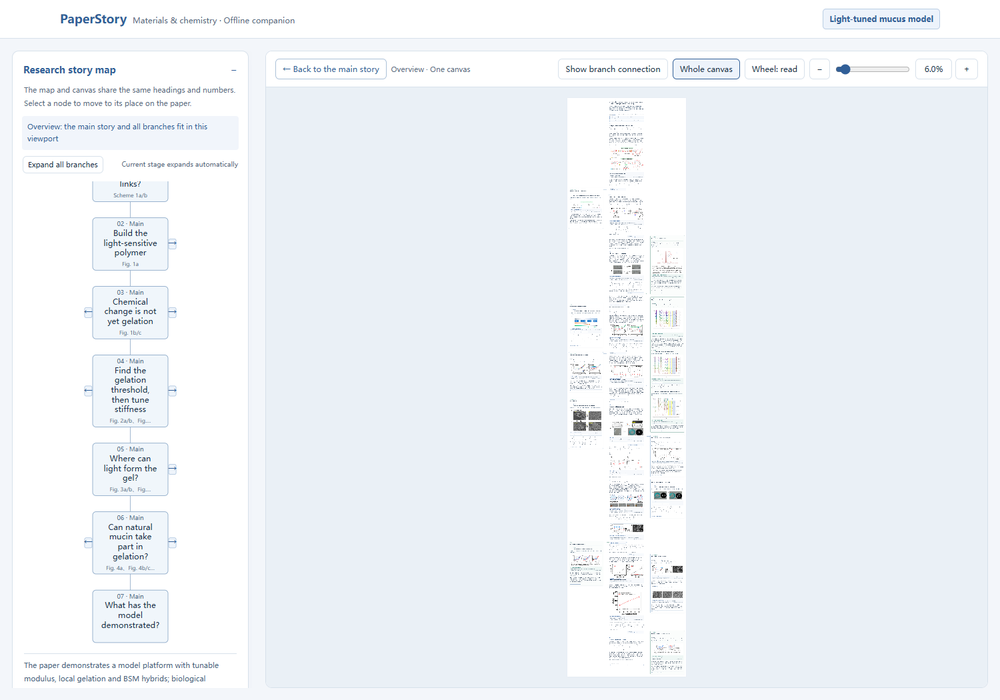
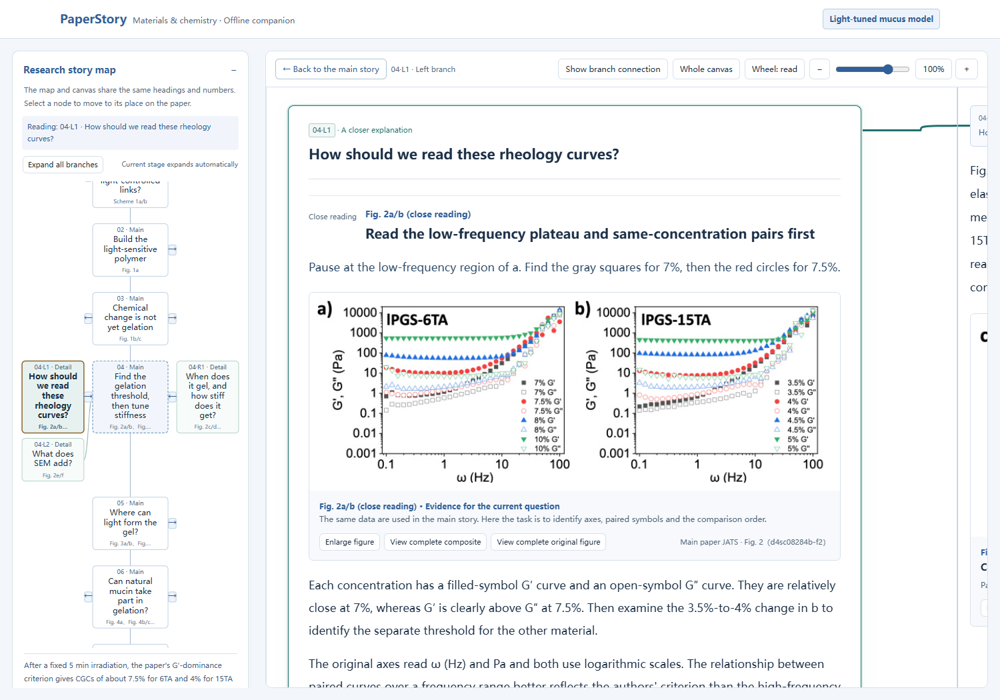
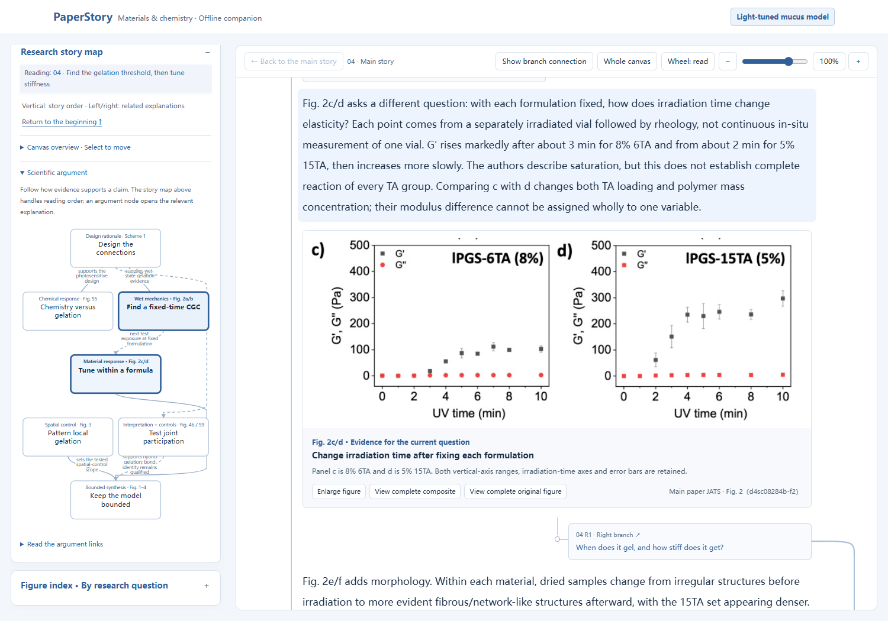

# PaperStory · Read papers as research stories

[**English live demo**](https://xuehb5.github.io/paper-story-reader/demo-en/A.html?v=0.21.0) · [**Download English Skill**](https://github.com/xuehb5/paper-story-reader/releases/download/v0.21.0/paper-story-reader-en-v0.21.0.zip) · [中文说明](README.md)

**Find the research story beneath dense terminology and complex figures.**

Reading a paper can feel like moving between unfamiliar terms, experimental details, composite figures and supplementary files without seeing how they fit together. Yet the research often follows a compelling line of inquiry: a problem, a design choice, a way to test it, and evidence that changes what we know.

We built **PaperStory** to make that logic visible. Its aim is to help readers understand why a study was undertaken, what was done, how it was tested and what the results mean. The prose follows a story trunk; left and right branches unpack concepts, structures, difficult figures and controls when deeper explanation is useful. The main article and its own Supporting Information contribute to the same explanation.

The current focus is experimental materials and chemistry papers, for readers with relevant subject knowledge who are encountering a paper for the first time. The narrative stays grounded in the sources: uncertainty, missing evidence and limits remain visible.



The explanatory prose is the main deliverable. A synchronized reading map, a separate scientific argument graph, and left/right branches help readers locate explanations. The reader uses one pannable, zoomable canvas with animated camera movement. Original figures and source files remain available locally.

## See the reading experience

These are actual screenshots of the complete English hydrogel-paper companion, generated by the same renderer as the live demo. Its 7 story stages, 25 figure occurrences, 11 branches and 14 close-reading tasks preserve the original reading design. [English screenshot tour](docs/gallery.en.md).



The trunk preserves the main argument. The camera moves along the same paper to a branch, where a difficult reading task can be explained step by step.

| Read a complex figure step by step | Bring SI into the right part of the story |
| --- | --- |
| [](docs/images/en-figure.png) | [](docs/images/en-argument.png) |
| Identify samples, symbols and comparisons, then connect the observation back to the question. | Inspect actual evidence relationships and move to the paragraph that explains a judgment. |

[English narrow-screen reading](docs/images/en-mobile.png) · [English worked-example sources and review scope](examples/hydrogel-en/README.md)

The Agent reads and interprets the paper. Python validates evidence records and renders the reader; this repository does not bundle a language model or automatically certify scientific correctness. The English edition writes directly in English: instructions, explanatory prose, figure walkthroughs, branches, maps and interface labels. It does not require an intermediate Chinese translation.

## Install the English edition

Download the **English Skill ZIP** above and import the complete `paper-story-reader` folder into an Agent that supports local `SKILL.md`, file/image reading and Python. Keep `scripts`, `assets`, `references`, `agents` and `reader-defaults.json` together. The package includes English instructions and reference contracts, shared rendering code and an English default; it contains no model, login credentials or scientific PDF collection.

The repository root retains the Chinese entrypoint. To build the English installation package from a checkout:

```bash
python scripts/package_skill.py --language en --output build/paper-story-reader-en.zip
```

Both editions use the same Skill ID and renderer. Choose one installation rather than installing two folders with the same ID. An explicit `case.language` overrides the edition default; use `"en"` for portable English input. Authored scientific content is never automatically translated by the UI.

## Run the worked example

Python 3.10+; `pypdf` is needed for PDF text checks. JATS parsing and the core renderer use the standard library. Work inside a virtual environment.

```bash
git clone https://github.com/xuehb5/paper-story-reader.git
cd paper-story-reader
python -m pip install -r requirements.txt
python scripts/render_reader.py examples/hydrogel-en/reader-input.json --review examples/hydrogel-en/evidence-review.json --context-audit examples/hydrogel-en/context-audit.json --output build/hydrogel-en
python scripts/verify_delivery.py build/hydrogel-en/A.html build/hydrogel-en/A.md --language en --manifest build/hydrogel-en/delivery-manifest.json
```

Open `build/hydrogel-en/index.html`. Use a new empty output directory for every revision. Rebuilding this example replays saved, reviewed content; it is not a new model run or an experimental reproduction. Default output embeds images for offline portability. Add `--link-assets` for static hosting and retain the full output directory; this is the same UI with separately loaded local images.

## Use with an Agent

Use the English installation above, or read the [English entrypoint](editions/en/SKILL.md) with its linked references and shared scripts. Supply the main paper, its **own matching SI** and clear original figures. If SI or a necessary figure is missing, the Skill asks for it and discloses the gap; it must not invent missing evidence. See the [English data contract](references/en/portable-reader.md).

> Use $paper-story-reader. Explain this materials/chemistry paper and its matching SI directly in English for a reader with subject knowledge who is new to this paper. Build a coherent story of the problem, design, tests, observations and bounded conclusions. Keep the main story readable on its own, with substantial nearby figure/SI branches, a synchronized story map, a separate scientific argument graph and the shared interactive canvas. Preserve original evidence and state material gaps.

Complete builds require actual evidence records. `--draft` explicitly marks an unreviewed preview. Hashes, coverage checks and condition checks do not determine scientific entailment or prove that a reader understood the paper.

## Development and licensing

Run `python -m unittest discover -s tests -v`. See [CONTRIBUTING.md](CONTRIBUTING.md).

Original code, skill instructions and project documentation are MIT licensed. Article/SI/figure materials in the hydrogel example retain their original CC BY 3.0 license. See [third-party notices](THIRD_PARTY_NOTICES.md). No affiliation with the paper authors, publisher or Agent platforms is implied.

## Contact

- Email: [2430112282@qq.com](mailto:2430112282@qq.com)
- WeChat: `XHB18085285748`
