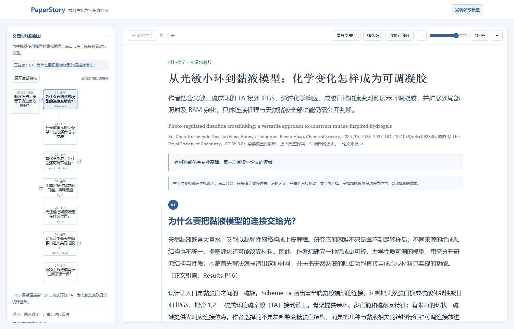
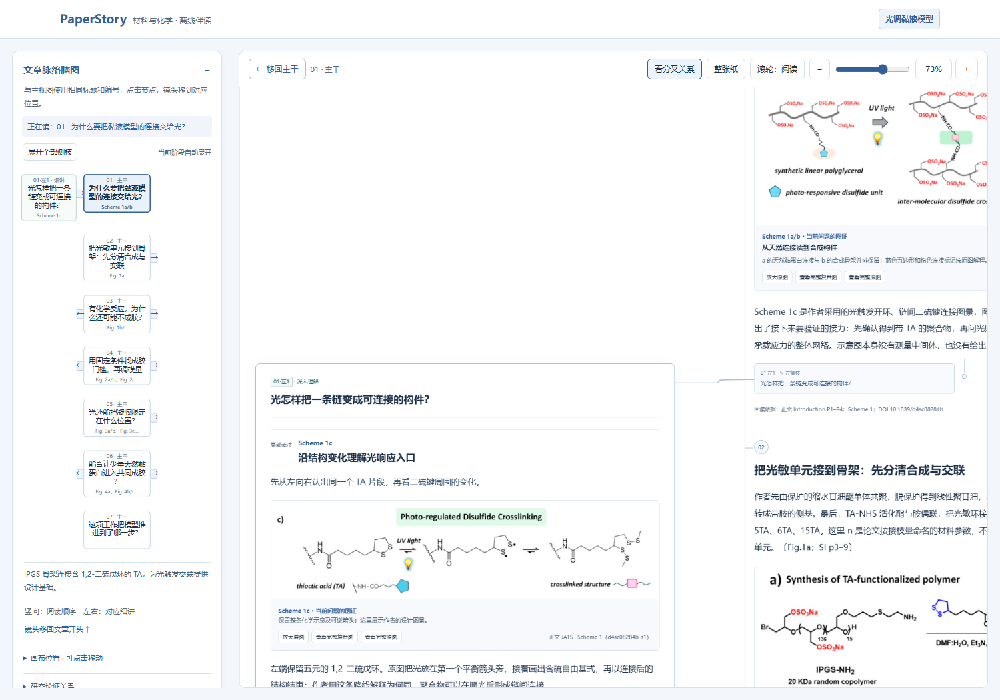
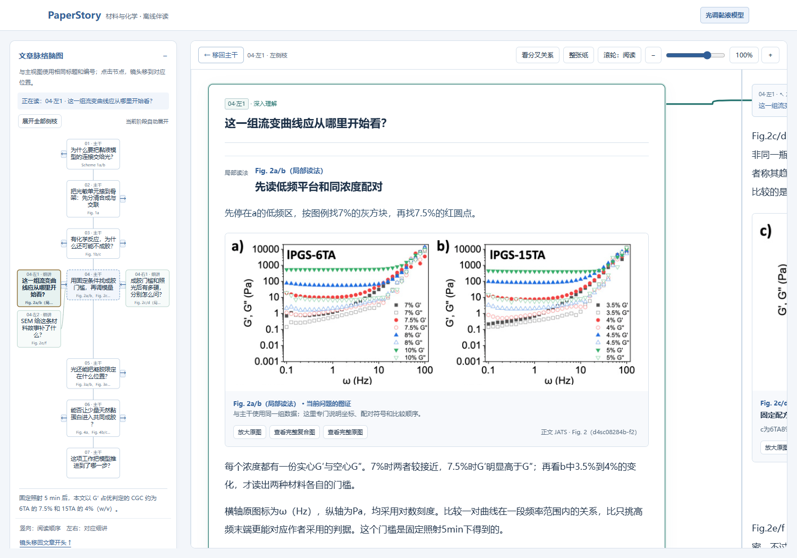
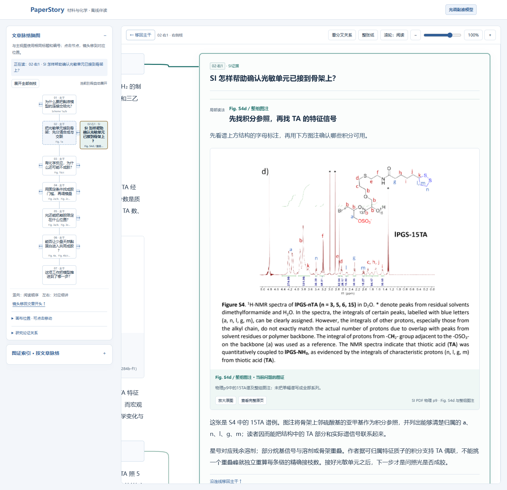
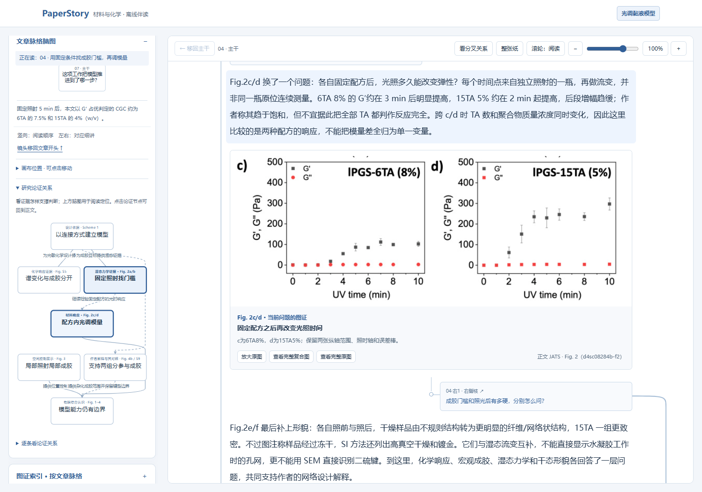
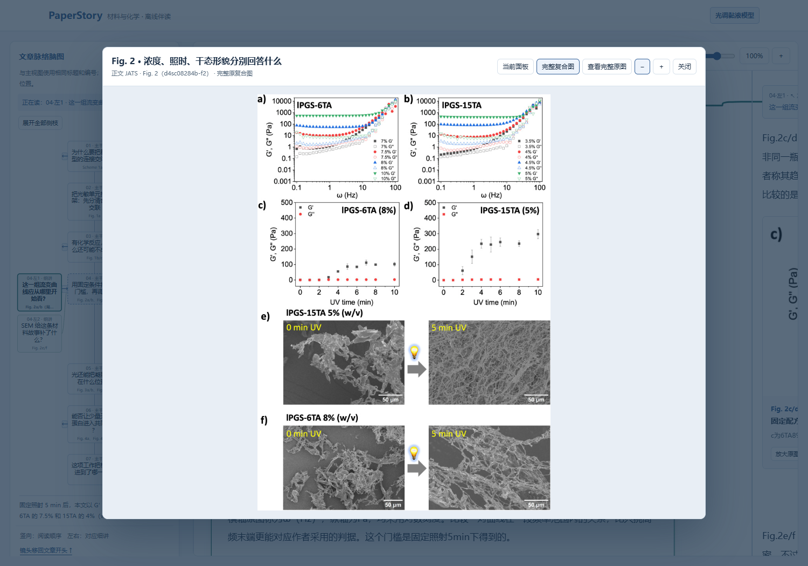

# PaperStory｜论文故事线 · 跨学科论文阅读 Skill

**v0.24.0：跨学科研究故事阅读。** 按实验、计算、观察、理论、证据综合与解释性研究组织论文，并加入故事树语义复核：核对主要结果是否遗漏、定义与推理是否连贯、转述是否忠实原文。[本轮语义审阅范围](docs/semantic-audit-024.md)。

[**在线体验**](https://xuehb5.github.io/paper-story-reader/demo/) · [**下载 Skill**](https://github.com/xuehb5/paper-story-reader/releases/latest) · [English](README.en.md) · [使用流程](docs/usage.md) · [数据契约](references/portable-reader.md) · [可运行示例](examples/hydrogel/README.md)

**中英文双版本**：面向英文读者直接成文，指令、参考资料、故事正文、图解、脑图与按钮均支持英文，无需先译为中文。[英文 Skill 安装包](https://github.com/xuehb5/paper-story-reader/releases/download/v0.24.0/paper-story-reader-en-v0.24.0.zip) · [完整英文交互示例](https://xuehb5.github.io/paper-story-reader/demo-en/A.html?v=0.24.0)。中文入口继续保留，两版共用同一套画布和生成器。

**读懂藏在专业术语与复杂图表背后的研究故事。**

阅读论文常常让人感到枯燥：陌生的缩写、密集的实验描述、层层嵌套的复合图，还有需要来回翻找的补充信息。读者花了很久看完这些细节，仍可能说不清作者为什么做这项研究、为什么选择这种方法，以及结果究竟回答了什么。

但一项研究往往藏着一条精妙的故事线：从一个尚未解决的问题出发，提出设计，选择方法，用实验、数据、证明或文本论证检验，再让证据推动认识前进。**PaperStory 的初衷，就是拨开繁杂表达，把这条逻辑线展现出来。** 我们希望读者更高效地理解论文的来龙去脉，也能理解每一张关键图为什么出现在这里。

我们把这种阅读组织成**树状脉络**：正文沿研究故事的主干推进，讲清“为什么做—做了什么—怎样做—发现了什么”；遇到需要深挖的结构、概念、复杂图或对照实验，再沿左右侧枝逐层展开。主文与相关的同篇 Supporting Information（SI）、附录或补充材料共同参与解释，读完细节后可以回到主干继续阅读。

**主干读懂全貌，侧枝读透细节，图证回到原文。** 故事的展开顺序服务于理解，每个科学判断仍须忠实来源；缺失的证据和未决问题会被保留，不为叙事顺畅补造结论。

从材料、化学出发，现已扩展到跨学科研究阅读，默认读者有相关专业基础、第一次接触该文。正文是阅读主体，脑图帮助定位，研究论证图帮助看清证据之间的关系。



## 可以做什么

- **六类可组合研究路线**：实验、计算、观察、理论、证据综合、解释性研究；根据论文的实际问题、方法与论据组织故事，保留材料化学的专门检查。
- **图、表、公式与原文一起讲**：复杂图逐步细读，数据表保留比较对象，公式先讲定义与假设，短引文保留语境和定位。
- **主文 + SI 联合阅读**：保留原图号、面板、PDF 物理页或 JATS 锚点，点击图像回看完整图或原页。
- **同一张可缩放的纸面**：主干和左右侧枝共存；点击分叉时镜头动画移动，支持空白拖动、文字选择、滚轮阅读、缩放和返回主干。
- **两类导航**：阅读脑图与正文共享节点；研究论证图单独表达支持、比较、解释和边界，并定位到正文段落。
- **来源核查记录**：保存对象、状态、条件、指标、原文摘录/实际读图记录，区分观察、作者解释和外推。
- **离线交付**：生成 HTML、Markdown、共享图谱与本地来源文件；读本无需登录、模型 API、Node 或外部 CDN。

这是一个 **Agent Skill + Python 生成工具**。Agent 负责阅读原文、看图和组织解释；脚本检查记录与文件的一致性，并生成界面。它没有自带语言模型，也不会仅凭 PDF 自动产出可靠解读。

## 看看它怎样帮助阅读

以下均为随包生成器生成的真实水凝胶论文读本截图，来自同一篇主文与SI。[查看全部截图、操作和对应阅读任务](docs/gallery.md)。

**沿同一张纸深入一个问题。** 主干、侧枝和连线同时存在；“看分叉关系”把来源和细讲一起纳入视野，点侧枝时镜头再移近阅读。



**把复杂图揉开，讲清先看哪里。** 这条侧枝先认浓度、实心/空心符号和低频平台，再将观察接回“怎样判断成胶”的主线；完整复合图随时可回看。



**让SI在真正需要的位置参与故事。** 主文介绍光敏构件的制备，侧枝用SI中的结构标注与NMR积分说明怎样理解接枝判定；脑图同时标明当前所在的侧枝。



| 看清证据如何支撑判断 | 从局部图回看完整原图 |
| --- | --- |
| [](docs/images/argument-navigation.png) | [](docs/images/composite-source.png) |
| 研究论证图表达支持、比较、解释和边界，点击可定位到正文。 | 局部讲解保留原图上下文，坐标、图例和其他面板可一起核对。 |

[查看整张画布全景](docs/images/whole-canvas-overview.png) · [打开可放大的完整画布长图](docs/images/whole-canvas.png)。

另一条[SI时间曲线侧枝](docs/images/si-time-comparison.png)展示主文Fig.4i怎样与Fig.S13的完整频率曲线合读。

## 立即体验示例

需要 Python 3.10 或更新版本。PDF 文本核查需要 `pypdf`；JATS 处理和核心渲染使用标准库。

```bash
git clone https://github.com/xuehb5/paper-story-reader.git
cd paper-story-reader
python -m venv .venv
# 激活虚拟环境后：
python -m pip install -r requirements.txt
python scripts/render_reader.py examples/hydrogel/reader-input.json --review examples/hydrogel/evidence-review.json --context-audit examples/hydrogel/context-audit.json --output build/hydrogel
python scripts/verify_delivery.py build/hydrogel/A.html build/hydrogel/A.md --manifest build/hydrogel/delivery-manifest.json
```

在线示例也使用这套正文、脑图和同纸画布；仅以独立本地图片文件加快网页加载。静态托管可在构建时加 `--link-assets`，并发布整个输出目录。默认仍为嵌图的离线读本。

在浏览器打开 `build/hydrogel/index.html`。输出目录必须为空；修改后生成到新目录，以保留前一个版本。命令行编码有问题时可使用 `python -X utf8`。

示例来自真实的光调二硫交联水凝胶论文，包含完整来源文件、25处图证、11条实质侧枝和14处局部读图。合成结构、流变判据、空间成胶和BSM杂化各自在故事中出现，SI在相应疑问处补充。重新构建重放保存的导读及核查记录，不会重新调用模型或复现原始科学实验。[示例范围与许可](examples/hydrogel/README.md)。

## 用于自己的论文

将本仓库完整文件夹导入支持本地 `SKILL.md` 的 Agent；至少保留 `SKILL.md`、`scripts/`、`references/`、`assets/`。也可直接把这些文件交给 Agent，明确要求按入口流程工作。不同宿主的安装入口以其说明为准。

提供论文主文，以及与理解有关的同篇 SI、附录和清晰原图；没有发表 SI 的论文不必补造附件。可以这样开始：

> 使用 paper-story-reader。面向有本专业基础、第一次接触这篇论文的读者，把主文和同篇 SI 串成研究故事。先解释问题、设计及关键比较，再讲每张图如何支持判断。请生成正文优先、带脑图导航和左右侧枝的离线交互读本，保留原文定位，明确材料缺口与未决问题。

Agent 先读 [SKILL.md](SKILL.md)，按来源组织内容；完整读本需要 `reader-input.json`、`evidence-review.json`、`context-audit.json` 和实际来源/图像。不要直接把示例中的科学判断或核查结论移植到另一篇论文。[完整操作说明](docs/usage.md)。

## 工作方式


核查记录位于内部数据中，读者默认从一个读本入口进入，不必先读另一份审计报告。

## 可靠性与范围

六类路线已在 9 篇不同论文的样本中练习，涉及材料化学、生物、机器学习、教育观察、元分析、数学证明与概念哲学。四篇新增读本经过来源对照的故事逻辑审阅；这由同一 Agent 执行，不是独立评审或全学科准确率证明。中英文指令与界面共用同一生成器；扫描 PDF 仍需额外 OCR。[研究类型与扩展范围](docs/cross-disciplinary-candidate.md) · [样本验证](docs/expanded-validation-023.md)。

机械校验能发现丢失文件、哈希变化、旧核查记录、未覆盖文本和部分条件/指标冲突，**不能判定全部科学语义是否正确**。需要实际回看原文和图像。示例的核查方法与覆盖范围在记录中明确披露；没有真人阅读提速、普遍准确率或跨模型效果保证。

## 开发与贡献

```bash
python -m unittest discover -s tests -v
```

欢迎报告具体论文中的误读、导航错误或可复现的交互问题。请提供合法、必要的材料和操作步骤。[贡献说明](CONTRIBUTING.md) · [验证范围](docs/validation.md) · [设计参照](references/design-sources.md)。

## 许可证

原创代码、Skill 指令和项目说明采用 [MIT](LICENSE)。水凝胶示例中的论文、SI、原图与摘录按原始 **CC BY 3.0** 授权，不被 MIT 重新授权；详见 [THIRD_PARTY_NOTICES.md](THIRD_PARTY_NOTICES.md)。本项目独立维护，不代表论文作者、期刊或任何 Agent 平台。

## 联系作者

- 邮箱：[2430112282@qq.com](mailto:2430112282@qq.com)
- 微信：`XHB18085285748`
