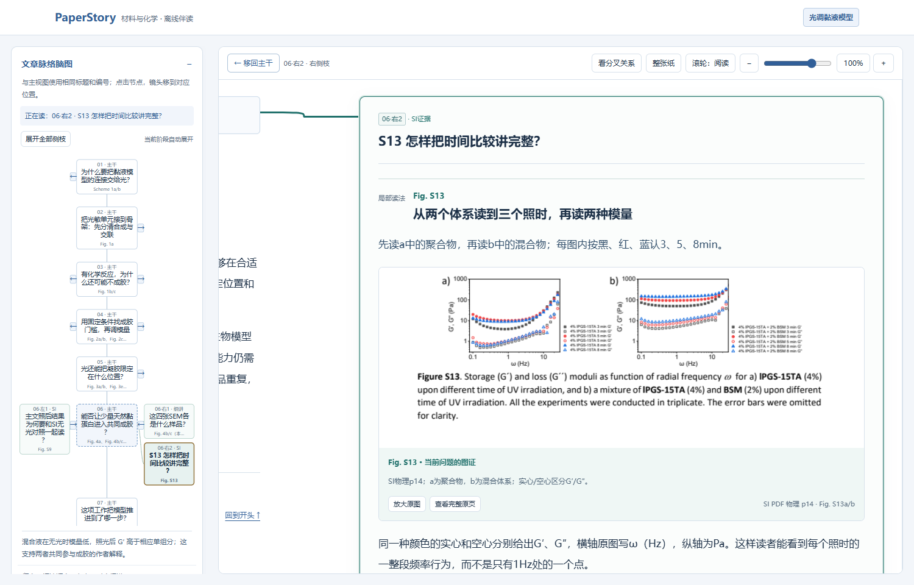

# PaperStory｜论文故事线

[**在线体验**](https://xuehb5.github.io/paper-story-reader/demo/) · [**下载 Skill**](https://github.com/xuehb5/paper-story-reader/releases/latest) · [English](README.en.md) · [使用流程](docs/usage.md) · [数据契约](references/portable-reader.md) · [可运行示例](examples/hydrogel/README.md)

**把一篇论文读成有依据的研究故事。** 面向有本专业基础、第一次接触该论文的读者，联合主文和同篇 Supporting Information（SI），解释为什么研究、怎样设计、如何检验、观察支持什么结论，以及结论的适用边界。

正文是阅读主体；脑图帮助定位。复杂图放回它回答的科学问题中讲解，必要的 SI 证据进入主线，较长解释放在左右侧枝。

**从“为什么做”读到“证据说明什么”，让复杂图与 SI 回到论文的故事线。**


## 可以做什么

- **材料、化学的研究逻辑**：围绕设计变量—实际结构与状态—性质/功能—构效解释，或反应条件—产物判定—范围—机制组织正文，按实际论文调整。
- **主文 + SI 联合阅读**：保留原图号、面板、PDF 物理页或 JATS 锚点，点击图像回看完整图或原页。
- **同一张可缩放的纸面**：主干和左右侧枝共存；点击分叉时镜头动画移动，支持空白拖动、文字选择、滚轮阅读、缩放和返回主干。
- **两类导航**：阅读脑图与正文共享节点；研究论证图单独表达支持、比较、解释和边界，并定位到正文段落。
- **来源核查记录**：保存对象、状态、条件、指标、原文摘录/实际读图记录，区分观察、作者解释和外推。
- **离线交付**：生成 HTML、Markdown、共享图谱与本地来源文件；读本无需登录、模型 API、Node 或外部 CDN。

这是一个 **Agent Skill + Python 生成工具**。Agent 负责阅读原文、看图和组织解释；脚本检查记录与文件的一致性，并生成界面。它没有自带语言模型，也不会仅凭 PDF 自动产出可靠解读。

下图是同一张纸上的 SI 细讲：脑图标明当前右侧枝，镜头沿连线移动；读完可以回到主干继续研究故事。



## 立即体验示例

需要 Python 3.10 或更新版本。PDF 文本核查需要 `pypdf`；JATS 处理和核心渲染使用标准库。

```bash
git clone https://github.com/xuehb5/paper-story-reader.git
cd paper-story-reader
python -m venv .venv
# 激活虚拟环境后：
python -m pip install -r requirements.txt
python scripts/render_reader.py examples/hydrogel/reader-input.json --review examples/hydrogel/evidence-review.json --context-audit examples/hydrogel/context-audit.json --output build/hydrogel
python scripts/verify_delivery.py build/hydrogel/A.html build/hydrogel/A.md --manifest build/hydrogel/delivery-manifest.json
```

在浏览器打开 `build/hydrogel/index.html`。输出目录必须为空；修改后生成到新目录，以保留前一个版本。命令行编码有问题时可使用 `python -X utf8`。

示例来自真实的光调二硫交联水凝胶论文，包含完整来源文件、25处图证、11条实质侧枝和14处局部读图。合成结构、流变判据、空间成胶和BSM杂化各自在故事中出现，SI在相应疑问处补充。重新构建重放保存的导读及核查记录，不会重新调用模型或复现原始科学实验。[示例范围与许可](examples/hydrogel/README.md)。

## 用于自己的论文

将本仓库完整文件夹导入支持本地 `SKILL.md` 的 Agent；至少保留 `SKILL.md`、`scripts/`、`references/`、`assets/`。也可直接把这些文件交给 Agent，明确要求按入口流程工作。不同宿主的安装入口以其说明为准。

同时提供论文主文、同篇 SI 及清晰原图。可以这样开始：

> 使用 paper-story-reader。面向有本专业基础、第一次接触这篇论文的读者，把主文和同篇 SI 串成研究故事。先解释问题、设计及关键比较，再讲每张图如何支持判断。请生成正文优先、带脑图导航和左右侧枝的离线交互读本，保留原文定位，明确材料缺口与未决问题。

Agent 先读 [SKILL.md](SKILL.md)，按来源组织内容；完整读本需要 `reader-input.json`、`evidence-review.json`、`context-audit.json` 和实际来源/图像。不要直接把示例中的科学判断或核查结论移植到另一篇论文。[完整操作说明](docs/usage.md)。

## 工作方式


核查记录位于内部数据中，读者默认从一个读本入口进入，不必先读另一份审计报告。

## 可靠性与范围

当前主要支持实验型材料和化学论文。理论、纯数据或综述需要按实际内容调整；扫描 PDF 需要额外 OCR。中文读本是目前主要验证的输出语言，英文 Agent 可以使用数据契约，但界面尚未完整国际化。

机械校验能发现丢失文件、哈希变化、旧核查记录、未覆盖文本和部分条件/指标冲突，**不能判定全部科学语义是否正确**。需要实际回看原文和图像。示例的核查方法与覆盖范围在记录中明确披露；没有真人阅读提速、普遍准确率或跨模型效果保证。

## 开发与贡献

```bash
python -m unittest discover -s tests -v
```

欢迎报告具体论文中的误读、导航错误或可复现的交互问题。请提供合法、必要的材料和操作步骤。[贡献说明](CONTRIBUTING.md) · [验证范围](docs/validation.md) · [设计参照](references/design-sources.md)。

## 许可证

原创代码、Skill 指令和项目说明采用 [MIT](LICENSE)。水凝胶示例中的论文、SI、原图与摘录按原始 **CC BY 3.0** 授权，不被 MIT 重新授权；详见 [THIRD_PARTY_NOTICES.md](THIRD_PARTY_NOTICES.md)。本项目独立维护，不代表论文作者、期刊或任何 Agent 平台。
