# From a photosensitive ring to a mucus model: how chemical change becomes a tunable gel

The authors attach thioctic acid (TA), with its photosensitive disulfide ring, to lPGS. Chemical-response measurements, gelation thresholds and rheological comparisons establish a tunable gel platform, extended to patterned irradiation and BSM hybrids. The specific linkage mechanism and the full functions of natural mucus remain separate questions.

Photo-regulated disulfide crosslinking: a versatile approach to construct mucus-inspired hydrogels  
Rui Chen, Krishnendu Das, Jun Feng, Boonya Thongrom, Rainer Haag. Chemical Science, 2025, 16, 5528–5537. DOI: 10.1039/d4sc08284b. Original figures © The Royal Society of Chemistry, CC BY 3.0. The companion rearranges explanations while preserving original images and source-page views for SI details.
https://doi.org/10.1039/d4sc08284b

For readers with a materials or chemistry background who are new to this paper. Follow the main story first; use nearby branches for close figure reading and SI details.

## Why give a mucus model light-controlled links?

Natural mucus contains abundant water yet forms a viscoelastic network that protects epithelial surfaces. Studying it is difficult for more than a shortage of samples: composition and structure vary with the source, and extraction or purification may alter the material. The authors therefore seek a model with more controllable composition and mechanics, so that structure and properties can be investigated separately. This paper first addresses how to make that material; it does not treat the defensive functions of natural mucus as functions already demonstrated by the synthetic model. [Main-text Introduction; Results P16]

The design starts from disulfide connections between mucins. Scheme 1a depicts connections involving cysteine-rich terminal regions. In b, the natural protein is replaced by sulfated linear polyglycerol, lPGS, carrying thioctic acid (TA) with its 1,2-dithiolane ring. The backbone supplies hydrophilicity, multiple functional groups and sulfate groups; the strained cyclic disulfide supplies a light-responsive connection site. Rather than reproducing an entire glycoprotein, the authors bring selected mucus-related structural features and adjustable connections into one building block. [Scheme 1; Results P5]

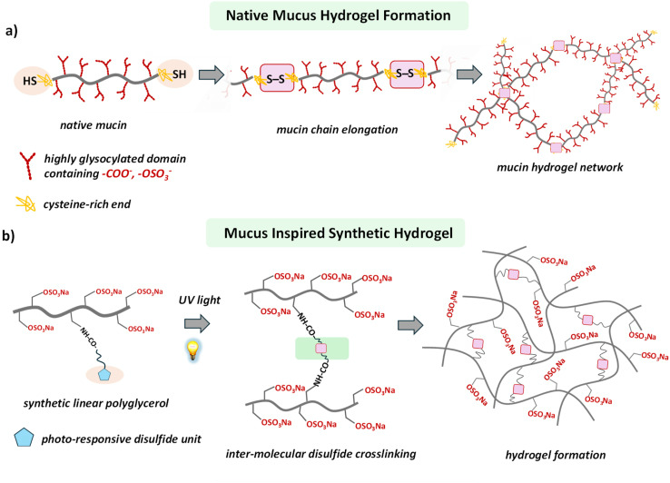

Natural mucin connections in a and the synthetic backbone in b are retained together; blue pentagons and pink connection marks are interpreted in the original figure's context.（Main paper JATS · Scheme 1（d4sc08284b-s1））

Scheme 1c presents the authors' picture of light-triggered ring opening and intermolecular disulfide linking. Its radical structures and reversible arrows belong to that chemical design explanation. The scheme sets up a sequence of tests: establish the TA-bearing polymer, ask whether light changes its local chemistry, and only then ask whether those changes produce a sample-spanning, stress-bearing network. The scheme itself neither measures intermediates nor supplies repeated breaking-and-recovery cycle data.

01·L1 · How does light make TA connectable?

### Close reading · Scheme 1c：Follow the structural change that introduces light responsiveness

Identify the same TA fragment from left to right, then follow the changes around the disulfide bond.

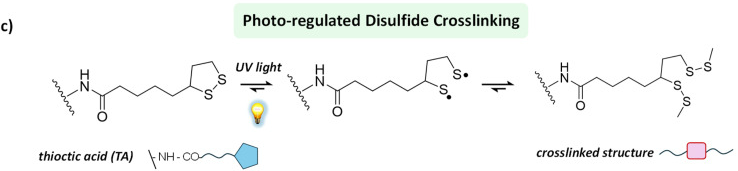

The complete chemical scheme and reversible arrows are retained. This is the authors' design picture.（Main paper JATS · Scheme 1（d4sc08284b-s1））

At the left is the five-membered 1,2-dithiolane ring. The original scheme places light beside the first equilibrium arrow, then depicts sulfur-centered radical structures and, finally, a linked structure. The authors use this route to explain why irradiated polymers could form intermolecular connections.

Return to the main story with three experimental tasks in mind: prepare the TA-bearing building block, observe its chemical response to light, and test formation of a bulk gel. Scheme 1c is a design explanation; linking efficiency, macroscopic modulus and cyclic recovery each require their own experimental evidence.

Return to the source: Main paper Introduction P1–P4; Scheme 1; DOI 10.1039/d4sc08284b

## Build the light-sensitive polymer

The authors first copolymerize protected glycidyl ether monomers, deprotect to obtain linear polyglycerol, and then sulfate it. Remaining allyl groups react with cysteamine by thiol–ene chemistry to introduce amine-bearing side groups. Coupling these amines with the activated ester TA-NHS attaches the photosensitive ring. Varying the TA-NHS feed equivalents gives lPGS-3TA, -5TA, -6TA and -15TA. Here n is the paper's grafting-based material designation; it is not a single-molecule count showing that every chain contains exactly n units. [Fig. 1a; SI physical pp. 3–9]

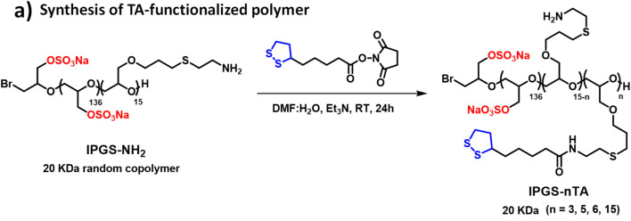

Reactants, arrow conditions and product labels are retained together; this detail belongs to the preparation stage.（Main paper JATS · Fig. 1（d4sc08284b-f1））

The SI does more than repeat the route. Fig. S4 uses the backbone methylene protons adjacent to sulfate groups as an integration reference and uses assignable TA proton signals to support coupling. Its caption also notes overlap of some alkyl signals with residual solvent and backbone resonances, so every integral is not expected to match exactly. This supports using the grafting series as a basis for later comparisons, without converting the height of an overlapping peak into the TA distribution on individual chains. [SI physical p. 9, Fig. S4 caption]

02·R1 · How does SI establish TA grafting?

### Close reading · Fig. S4d / complete caption：Find the integration reference, then the characteristic TA signals

Read the letter assignments on the structure above the spectrum, then check which integrals the caption identifies as usable.

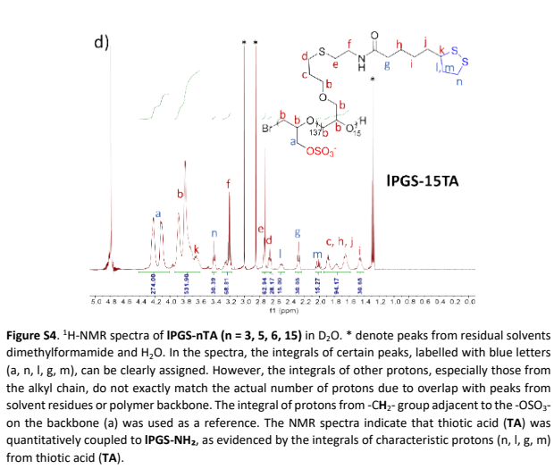

The 15TA spectrum on physical p. 9 and the full set's caption are retained; one spectrum is not presented as the entire series.（SI PDF physical  p9 · Fig. S4d and complete caption）

This is the 15TA spectrum from S4. The caption identifies backbone methylene protons next to sulfate groups as the integration reference and lists clearly assignable signals a, n, l, g and m. These assignments connect the TA portion of the drawn structure to signals in the measured spectrum.

Asterisks mark residual solvent; some alkyl signals overlap with solvent or the backbone. The authors use integrals of assignable characteristic protons to support TA coupling. Picking an overlapping peak cannot independently establish an exact graft count on each chain. Once the light-sensitive unit is attached, the next question is whether irradiation produces a gel.

A stage distinction matters here. The statement that no additional photoinitiator or oxidant is needed concerns photo-crosslinking of the final lPGS-nTA building block. For preparation of lPGS-NH₂, SI physical p. 5 explicitly adds 65 mg of a photoinitiator labeled Irgacure 259, followed by 3 h irradiation and dialysis. TA coupling also uses DMF/water and triethylamine. An advantage of the terminal crosslinking step cannot be extended to the entire preparation route, nor does it establish biological safety of the final product.

Return to the source: Main paper Fig.1a，Results P6; SIphysical p3–9，Scheme S1, Fig.S1–S4

## Chemical change is not yet gelation

Start with the macroscopic question in Fig. 1b/c: does the liquid still flow when the vial is tilted? In 10 mM PBS at pH 7.4, 5% (w/v) lPGS-15TA forms a self-supporting gel after 5 min at 370 nm and 25 mW/cm². A 10% lPGS-3TA solution remains a solution even after 60 min. The percentages are mass/volume concentrations: 5% w/v means 5 g polymer per 100 mL solution, not the mass fraction of TA in the polymer. These photographs differ simultaneously in TA loading, concentration and irradiation time. They show outcomes for the tested formulations, not the isolated causal effect of TA loading.

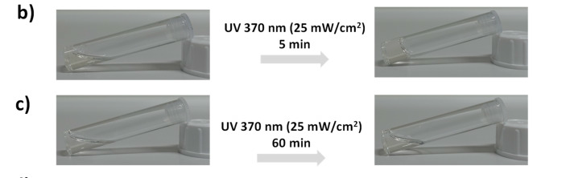

Photographs b/c, exposure times and illumination conditions are retained together. See the adjacent prose for the formulations.（Main paper JATS · Fig. 1（d4sc08284b-f1））

The SI's non-gelling controls prevent an important misreading. After irradiation, Fig. S5a (3% lPGS-15TA) and b (6% lPGS-15TA) both show weakening of characteristic TA peaks and merging of initially resolved signals. The main text reports that the former still flows while the latter gels. Panel c (10% lPGS-3TA) also shows spectral changes without macroscopic gelation. The authors interpret the spectral changes as ring opening and polymerization/crosslinking, and explain non-gelation in terms of insufficient network connectivity. Local chemical change and a sample-spanning network are different criteria; NMR alone does not count every intermolecular link. [Main-text Results P7; SI physical pp. 9–10]

03·R1 · Why does the spectrum change without a gel?

### Close reading · Fig. S5a：Begin with a spectrum from a non-gelling formulation

Start at the bottom, at 0 min, and follow the same chemical-shift regions upward.

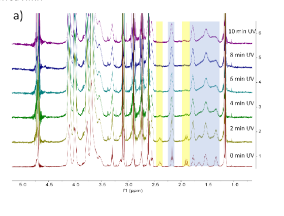

3% lPGS-15TA: irradiation time increases upward from 0 min. Chemical shifts and the original highlighted regions are retained.（SI PDF physical  p9 · Fig. S5a）

The colored regions guide the reading: yellow marks characteristic protons on the TA ring, while blue marks other TA alkyl signals that were initially better resolved. Moving through irradiation times shows changes in those local signals. The vertical stacking is not a gel-fraction scale.

The main text describes this 3% 15TA sample as still flowing, although its spectrum already shows changes the authors associate with ring opening/polymerization. Keep two levels distinct in the main story: whether local photochemistry occurs, and whether sufficient connectivity develops to produce a bulk network.

### Close reading · Fig. S5b：Test the distinction with two more formulations

Read panel b, 6% 15TA, again following the same signal regions upward from 0 min.

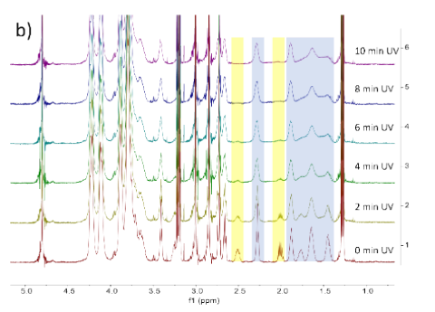

Panel b on SI physical p. 10 retains the chemical-shift axis, time labels and highlighted regions; the full caption is available in the source-page view.（SI PDF physical  p10 · Fig. S5b/c）

The main text reports gelation for 6% 15TA and interprets its difference from 3% 15TA as sufficient versus insufficient network formation. First compare two concentrations of the same 15TA material; then move to the next example, where grafting level changes too.

### Close reading · Fig. S5c：Use the 3TA formulation to examine another non-gelling case

Identify panel c as 10% 3TA, then follow the spectra from 0 min at the bottom to 10 min at the top.

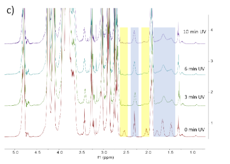

Panel c on SI physical p. 10 retains the 0, 3, 6 and 10 min labels and the chemical-shift axis.（SI PDF physical  p10 · Fig. S5b/c）

This sample remains a solution in the main-text vial test, yet its spectrum changes with irradiation time. Reading it alongside the two 15TA formulations explains why the authors separate chemical response from macroscopic network formation as two questions requiring evidence.

Here, therefore, 'does not gel' is not synonymous with 'no photochemical change.' Table S1 also records gelation for 10% 5TA after 10 min and 8% 6TA after 5 min, supporting further exploration of grafting level and polymer concentration. It lists tested successful and unsuccessful formulations, not an exhaustive gelation phase diagram for every material. The next step fixes irradiation conditions and uses mechanics to turn apparent non-flow into a comparable criterion.

03·L1 · What does Fig. 1d actually summarize?

### Close reading · Fig. 1d：Separate the series schematic from actual experimental conditions

Identify 3TA, 5TA, 6TA and 15TA from left to right, then read what each of the three wedges represents.

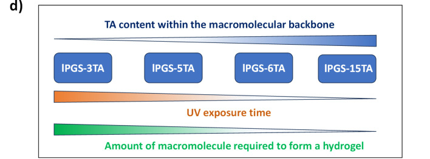

Panel d summarizes the series schematically; actual tested successful and unsuccessful formulations require the main text and Table S1.（Main paper JATS · Fig. 1（d4sc08284b-f1））

The upper blue wedge represents the number of TA units on the backbone. The lower wedges summarize trends in irradiation time and the amount of building block needed for gelation. The diagram helps explain why the authors next tune grafting level and concentration.

Return to the main text and Table S1 for actual values. Different formulations change grafting level, concentration and irradiation time together; these are outcomes under the tested conditions. The next stage fixes illumination and uses rheology to locate comparable gelation thresholds.

Return to the source: Main paper Fig.1b–d，Results P6–P7; SIphysical p9–11，Fig.S5, Table S1

## Find the gelation threshold, then tune stiffness

Oscillatory rheology subjects the sample to periodic shear at small deformation. G′ describes the elastic storage response and G″ the dissipative response. The authors first identify the linear viscoelastic range, then sweep frequency at 1% strain. Fig. 2a/b asks how much polymer is needed for gel-like behavior after the same 5 min irradiation. Both axes are logarithmic; the original horizontal axis reads ω (Hz), which is retained here rather than silently converted to rad/s, and the vertical axis is in Pa. Filled symbols indicate G′ and matching open symbols G″. Compare paired symbols for the same concentration and the low-frequency plateau, rather than selecting only the high-frequency upturn.

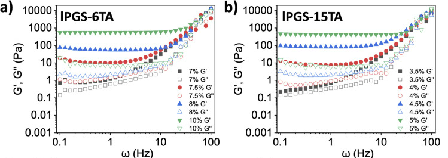

Panels a/b retain paired axes, concentration legends and filled/open symbols; exposure is 5 min and strain 1%.（Main paper JATS · Fig. 2（d4sc08284b-f2））

Under the same 370 nm, 25 mW/cm², 5 min irradiation, G′ becomes clearly dominant as 6TA increases from 7% to 7.5% and 15TA from 3.5% to 4%. The authors accordingly report critical gelation concentrations (CGCs) of approximately 7.5% and 4%, respectively. These are operational thresholds at the specified irradiation time, not condition-independent constants. At the CGC and 1 Hz, the text reports G′ around 7–10 Pa and G″ around 1 Pa, relating these to cited healthy-airway-mucus values. This is not a same-batch natural-mucus control, and it does not place gels at every concentration within that range.

04·L1 · How should we read these rheology curves?

### Close reading · Fig. 2a/b (close reading)：Read the low-frequency plateau and same-concentration pairs first

Pause at the low-frequency region of a. Find the gray squares for 7%, then the red circles for 7.5%.

The same data are used in the main story. Here the task is to identify axes, paired symbols and the comparison order.（Main paper JATS · Fig. 2（d4sc08284b-f2））

Each concentration has a filled-symbol G′ curve and an open-symbol G″ curve. They are relatively close at 7%, whereas G′ is clearly above G″ at 7.5%. Then examine the 3.5%-to-4% change in b to identify the separate threshold for the other material.

The original axes read ω (Hz) and Pa and both use logarithmic scales. The relationship between paired curves over a frequency range better reflects the authors' criterion than the high-frequency endpoint alone. This threshold was obtained after a fixed 5 min irradiation.

Fig. 2c/d asks a different question: with each formulation fixed, how does irradiation time change elasticity? Each point comes from a separately irradiated vial followed by rheology, not continuous in-situ measurement of one vial. G′ rises markedly after about 3 min for 8% 6TA and from about 2 min for 5% 15TA, then increases more slowly. The authors describe saturation, but this does not establish complete reaction of every TA group. Comparing c with d changes both TA loading and polymer mass concentration; their modulus difference cannot be assigned wholly to one variable.

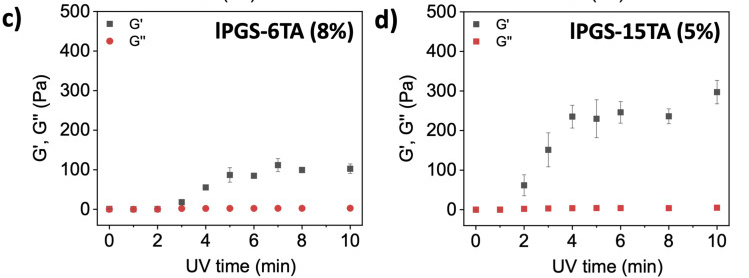

Panel c is 8% 6TA and d is 5% 15TA. Both vertical-axis ranges, irradiation-time axes and error bars are retained.（Main paper JATS · Fig. 2（d4sc08284b-f2））

04·R1 · When does it gel, and how stiff does it get?

### Close reading · Fig. 2c/d (close reading)：Read irradiation time horizontally and each formulation's modulus vertically

Follow the black squares against minutes in c, then read d in the same way.

Each point comes from an independently irradiated sample. Check both formulation and vertical-axis range across panels.（Main paper JATS · Fig. 2（d4sc08284b-f2））

Each panel holds its own concentration fixed, so within that panel one can ask how longer irradiation changes the response. The initial low modulus, subsequent rise and later leveling show light functioning as a tuning handle rather than merely an on/off switch.

Across c and d, both TA loading and mass concentration change, and the vertical-axis ranges differ. Read these as the responses of two formulations. This is distinct from the minimum gelation concentration addressed by a/b.

Fig. 2e/f adds morphology. Within each material, dried samples change from irregular structures before irradiation to more evident fibrous/network-like structures afterward, with the 15TA set appearing denser. However, the caption specifies lyophilization; the SI method also lists high-vacuum drying and gold coating. These images complement wet-state rheology but do not directly show the hydrogel's working hydrated pore network or identify disulfide bonds. Chemical response, macroscopic gelation, wet mechanics and dry morphology answer different parts of the problem, together supporting the authors' network-design interpretation.

04·L2 · What does SEM add?

### Close reading · Fig. 2e/f：Compare before and after irradiation within each row

Read the 15TA row e, then the 6TA row f, keeping each scale bar and specimen state in view.

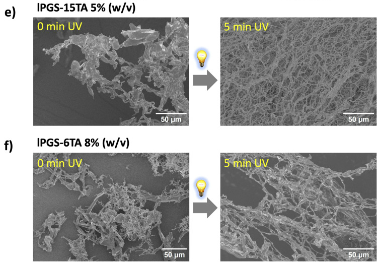

Each row retains before/after irradiation and its 50 μm scale bar. The caption identifies the specimens as lyophilized.（Main paper JATS · Fig. 2（d4sc08284b-f2））

Within each row, move from the unirradiated specimen at the left to the irradiated specimen at the right. The fibrous/network-like morphology changes under the gel-forming conditions. This adds a morphological observation to the preceding chemical response and bulk rheology.

The caption specifies lyophilized specimens, so these photographs show morphology after preparation. Wet-state elasticity comes from rheology; the connection chemistry is the authors' interpretation across several observations. Neither is replaced by a single SEM image.

Return to the source: Main paper Fig.2，Results P8–P14; SIphysical p2–3, 11–13，Fig.S6–S8

## Where can light form the gel?

If light only switched an entire vial on or off, its potential would remain partly unused. The authors place 4% lPGS-15TA in a 35 mm Petri dish and restrict illumination through a central 8 mm aperture. Fig. 3a is the setup schematic; b–d show actual shape outcomes. After 5 min, a transparent gel region remains while surrounding material still flows; changing masks produces circular, rectangular and triangular regions. Methylene blue is added after irradiation to help distinguish aqueous and gel regions, not to calculate crosslink density from blue intensity.

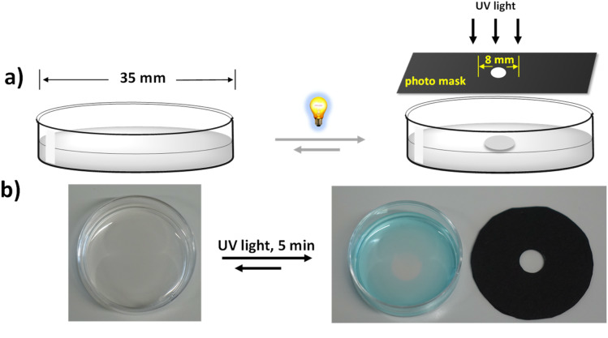

The setup schematic and actual dish/mask photographs are retained; b shows the outcome after local irradiation.（Main paper JATS · Fig. 3（d4sc08284b-f3））

05·R1 · How do mask shapes support spatial control?

### Close reading · Fig. 3c/d：Read each photomask together with its Petri dish

Find the opening in each black mask, then locate the corresponding region in the adjacent dish.

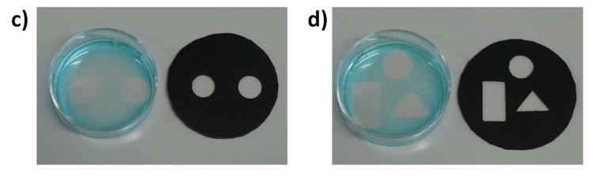

Circular, rectangular and triangular masks remain paired with their corresponding gel regions.（Main paper JATS · Fig. 3（d4sc08284b-f3））

Changing aperture geometry produces the corresponding circular, rectangular or triangular local gel. Methylene blue, added after illumination, helps distinguish the aqueous region and transparent gel. Its intensity is not a quantitative crosslink-density scale.

The photographs address whether an external light pattern can control position. Rheology of the locally extracted gel in e/f then connects that spatial result to the mechanical criterion already established.

Obtaining the intended shape is not enough: does the locally formed region show gel-like mechanics? Fig. 3e/f compares locally and uniformly formed samples. The original axes read ω (Hz) and modulus in Pa; black-square G′ lies above red-circle G″, giving comparable gel-like responses. Thus a spatially formed object is linked back to an elastic network. This demonstrates control of gelation position; geometric photographs do not themselves reproduce the spatial heterogeneity or defensive functions of natural mucus.

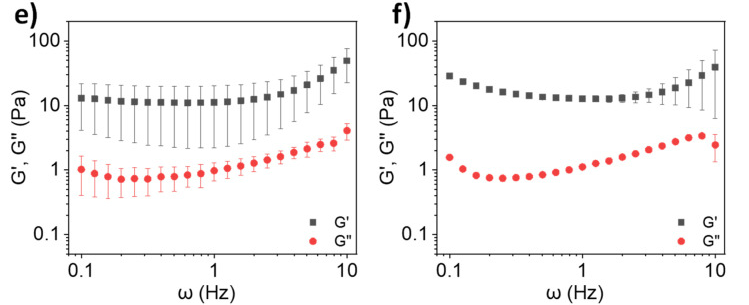

Panel e is the locally extracted gel and f the uniformly formed sample. Their axes and modulus legends are retained.（Main paper JATS · Fig. 3（d4sc08284b-f3））

Return to the source: Main paper Fig.3，Results P15

## Can natural mucin take part in gelation?

The final transition brings a natural component into the model. The authors describe limited gelation of commercial bovine submaxillary mucin (BSM) at physiological pH and cite substantially higher concentrations needed to approach healthy-sputum viscoelasticity. They therefore test whether the synthetic polymer can assist BSM. First identify the specimens in Fig. 4a: the leftmost vial is 4% BSM stock and the second is 8% lPGS-15TA stock. Only after mixing do the labels read 2% BSM + 4% polymer; the fourth image is the irradiated mixture gel. The first two photographs are not successive time points of the final mixture. [Fig. 4a; Results P16]

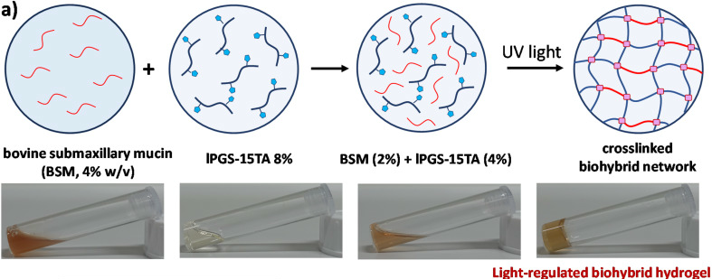

The 4% BSM and 8% polymer stock labels and the mixed 2% BSM + 4% polymer label are retained.（Main paper JATS · Fig. 4（d4sc08284b-f4））

Now read Fig. 4b together with the dark controls in SI. Fig. S9a shows low moduli for 4% polymer, 2% BSM and their mixture before irradiation: mixing alone does not generate the post-irradiation elastic plateau. Panels b/c add unirradiated controls with 4.5% and 5% polymer. Fig. 4b compares three groups after 5 min irradiation; the mixture has markedly higher low-frequency G′ than either component alone. Under shared irradiation and rheological conditions, this supports the authors' interpretation that both components participate in gelation. It separates adding BSM from thickening without light.

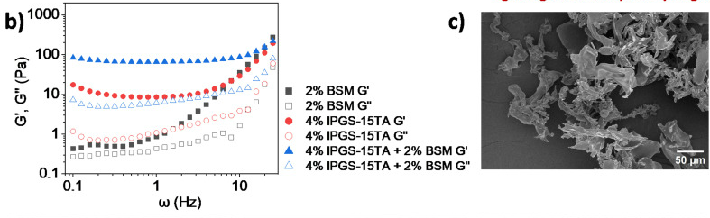

Read the three groups in left-hand panel b first. Adjacent panel c is retained so that b's full legend remains visible in context.（Main paper JATS · Fig. 4（d4sc08284b-f4））

06·L1 · Why pair Fig. 4b with a dark control?

### Close reading · Fig. S9：Separate the effects of mixing and irradiation

Identify both single components and the mixture in the legend of S9a, then compare with Fig. 4b in the main story.

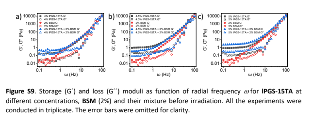

SI physical p. 13: a/b/c show dark controls with 4%, 4.5% and 5% polymer, respectively, at fixed 2% BSM.（SI PDF physical  p13 · Fig. S9a–c）

S9a supplies the pre-irradiation baseline for the same compositions. Polymer, BSM and their mixture all have low moduli, so simply mixing the stock solutions does not produce the irradiated elastic response.

Fig. 4b supplies the irradiated comparison: the hybrid's low-frequency G′ exceeds that of the corresponding single components. Together these observations support the authors' interpretation of joint participation in photo-regulated gelation, beyond what a photograph of a non-flowing vial alone can establish.

Fig. 4c–f is not a four-frame movie of one specimen: c is unirradiated 4% polymer, d unirradiated 2% BSM, e the unirradiated mixture and f the irradiated mixture; their scale bars also differ. The porous irradiated morphology complements the increased modulus. The authors further interpret this as BSM thiols participating in photo-regulated disulfide linking. This companion retains that as an author interpretation supported by several observations. Dry SEM and bulk rheology alone do not directly identify every BSM–polymer covalent connection or independently exclude all physical interactions.

06·R1 · Which sample is in each SEM panel?

### Close reading · Fig. 4b/c (read c on the right)：Use c to establish the identity of the polymer-only specimen

Identify 4% polymer, no irradiation and the 50 μm scale bar before interpreting morphology.

Read the polymer morphology and 50 μm scale bar in right-hand panel c; the neighboring b is the rheology panel.（Main paper JATS · Fig. 4（d4sc08284b-f4））

Panel c is an unirradiated single-component control. Comparing it with the irradiated mixture at the lower right changes both composition and treatment stage. Increased porosity alone cannot assign the change to a specific bond type.

### Close reading · Fig. 4d/e/f：Then read BSM, the mixture and the irradiated mixture in order

Identify d, e and f individually, checking their scale bars before comparing apparent density.

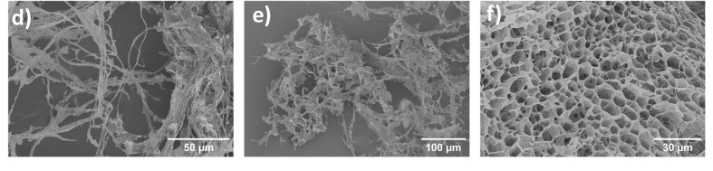

Panel d is BSM, e the unirradiated mixture and f the irradiated mixture; all three scale bars are retained.（Main paper JATS · Fig. 4（d4sc08284b-f4））

Panel d is 2% BSM, e the unirradiated mixture and f the irradiated mixture. The porous morphology in f complements the rheological increase. These are dried specimens; the authors' interpretation that BSM thiols participate in disulfide linking must be considered with the other evidence.

Two tuning series add further tests. Fig. 4g holds BSM at 2% while increasing polymer from 4% to 4.5% and 5%; h holds polymer at 4% while increasing BSM from 0.5% to 1% and 2%. G′ increases in both series, while G″ changes relatively little in h. These are separate concentration series with different vertical-axis ranges, so their plotted slopes should not be directly compared.

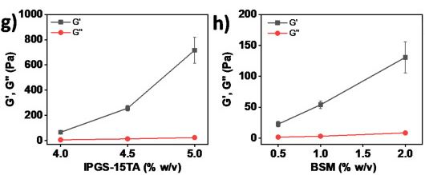

Panel g varies polymer at fixed BSM; h varies BSM at fixed polymer. Their y-axis ranges differ.（Main paper JATS · Fig. 4（d4sc08284b-f4））

Fig. 4i then compares irradiation times at each fixed formulation. Hybrid G′ rises markedly at 3, 5 and 8 min, whereas 4% polymer alone changes relatively little, further supporting the authors' interpretation that BSM participates in network formation.

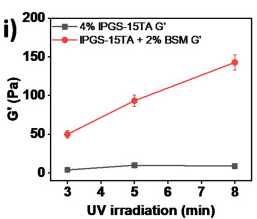

The two symbols show G′ for two systems. No G″ curve is shown.（Main paper JATS · Fig. 4（d4sc08284b-f4））

An aggregate caption can hide an important metric distinction here: Fig. 4i actually plots G′ only. Black squares represent polymer and red circles the hybrid. There is no G″ curve, so this panel cannot establish that G″ is unchanged with time. To see both moduli, read Fig. S13a/b on SI physical p. 14: at the same 3, 5 and 8 min times, filled/open symbols distinguish G′/G″ across a full frequency range. SI therefore supplies both a dark control and the missing metric context for the time comparison, rather than serving as a decorative attachment.

06·R2 · What does S13 add to the time comparison?

### Close reading · Fig. S13：Read two systems, then three exposure times, then the two moduli

Read polymer in a and the hybrid in b. Within each panel, black, red and blue denote 3, 5 and 8 min.

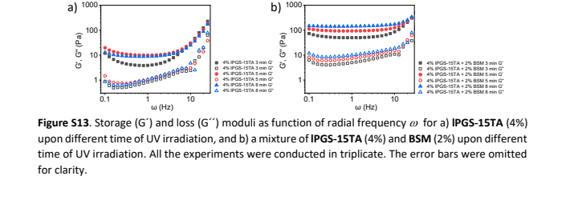

SI physical p. 14: a is polymer and b the hybrid; filled/open symbols distinguish G′/G″.（SI PDF physical  p14 · Fig. S13a/b）

For each color, filled and open symbols give G′ and G″. The original horizontal axis reads ω (Hz) and the vertical axis Pa. This reveals the frequency-dependent response at each exposure time rather than a single point at 1 Hz.

Fig. 4i selects G′ for the irradiation-time comparison of the two systems; it contains no G″ curve. S13 restores these time points to their full curves. It clarifies the support for the authors' BSM-participation interpretation while avoiding an invented claim that an unplotted loss modulus stays constant.

Return to the source: Main paper Fig.4，Results P16–P18; SIphysical p13–14，Fig.S9–S13

## What has the model demonstrated?

The contribution can be expressed as a bounded, testable sequence: attach light-responsive TA to lPGS; turn irradiation-induced local chemical change into gelation in suitable formulations; tune modulus through grafting level, concentration and exposure time under specified conditions; then extend that control to mask-defined positions and BSM hybrids. Samples that change spectrally without gelling are an important boundary of this sequence, not failures to omit from the story.

The best-supported meaning of 'mucus-inspired' is that selected structural features, a disulfide-crosslinking design and measured viscoelastic behavior are combined in one platform. The authors' prospects for biological models and other macromolecular materials warrant further testing. Pathogen defense, irradiation compatibility with live cells, long-term stability and repeated recovery require their own experiments; none follows from a G′ value near a natural-mucus range. A next close reading should inspect original rheology and sample replication for the intended application before designing tests of hydrated structure, linkage specificity and biological function.

Return to the source: Main paper Results P19, Conclusion; main paper Fig.1–4; SI methods and Fig.S5, S9, S13

## Reading navigation shared with the canvas

- [01 · Why give a mucus model light-controlled links?](#question)
- [02 · Build the light-sensitive polymer](#building)
- [03 · Chemical change is not yet gelation](#threshold)
- [04 · Find the gelation threshold, then tune stiffness](#mechanics)
- [05 · Where can light form the gel?](#space)
- [06 · Can natural mucin take part in gelation?](#hybrid)
- [07 · What has the model demonstrated?](#limits)
- [01·L1 · How does light make TA connectable?](#branch-question-1)
- [02·R1 · How does SI establish TA grafting?](#branch-building-1)
- [03·R1 · Why does the spectrum change without a gel?](#branch-threshold-1)
- [03·L1 · What does Fig. 1d actually summarize?](#branch-threshold-2)
- [04·L1 · How should we read these rheology curves?](#branch-mechanics-1)
- [04·R1 · When does it gel, and how stiff does it get?](#branch-mechanics-2)
- [04·L2 · What does SEM add?](#branch-mechanics-3)
- [05·R1 · How do mask shapes support spatial control?](#branch-space-1)
- [06·L1 · Why pair Fig. 4b with a dark control?](#branch-hybrid-1)
- [06·R1 · Which sample is in each SEM panel?](#branch-hybrid-2)
- [06·R2 · What does S13 add to the time comparison?](#branch-hybrid-3)

## Scientific argument

- [Chemistry versus gelation](#threshold-p2) → supports the photosensitive design → [Design the connections](#question-p2)（Evidence / comparison）
- [Find a fixed-time CGC](#mechanics-p2) → supplies wet-state gelation evidence → [Design the connections](#question-p2)（Evidence / comparison）
- [Find a fixed-time CGC](#mechanics-p2) → next test: exposure at fixed formulation → [Tune within a formula](#mechanics-p3)（Interpretation / next research question）
- [Design the connections](#question-p2) → proposes joint connections with BSM → [Test joint participation](#hybrid-p2)（Interpretation / next research question）
- [Pattern local gelation](#space-p1) → sets the tested spatial-control scope → [Keep the model bounded](#limits-p2)（Evidence / comparison）
- [Test joint participation](#hybrid-p2) → supports hybrid gelation; bond identity remains qualified → [Keep the model bounded](#limits-p2)（Interpretation / next research question）
- [Tune within a formula](#mechanics-p3) → sets the measured modulus-tuning scope → [Keep the model bounded](#limits-p2)（Evidence / comparison）

## Local source materials

- [Original RSC JATS article, DOI 10.1039/d4sc08284b; figure and paragraph anchors](sources/aa7fbf9234fc76dda718.xml)
- [Matching Supporting Information, 15 physical PDF pages](sources/ec4b2ac862a70573c4a2.pdf)

## Coverage

Coverage includes the scientific main text, captions and extractable text from all 15 SI pages. The original Scheme 1, Figs. 1–4 and SI physical pages 5, 9, 10, 13 and 14 were visually inspected in preparing the worked companion. The story covers grafting, chemical response versus gelation, rheology, local gelation and BSM hybrids. Other synthetic spectra were not independently integrated peak by peak; this is not a reproduction or independent validation of the original experiments.
