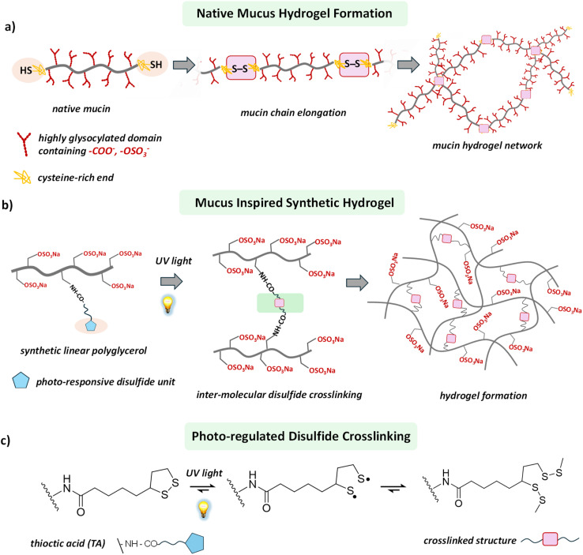
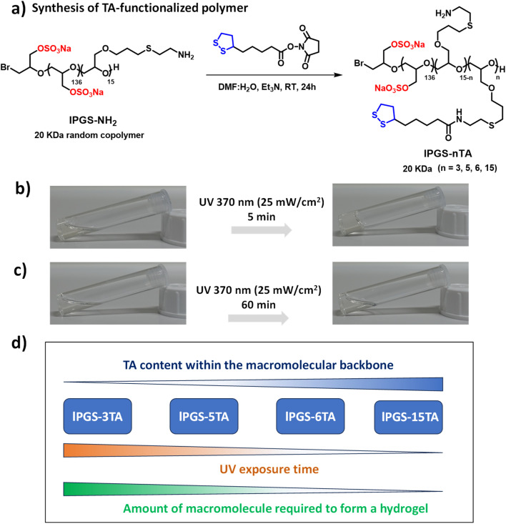
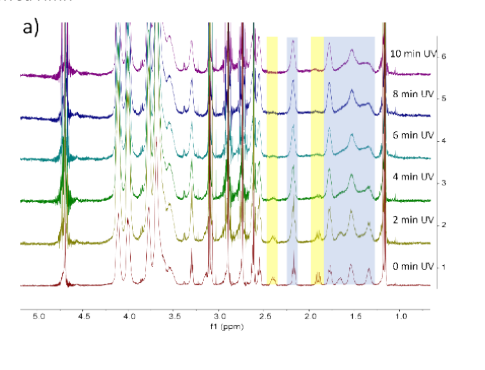
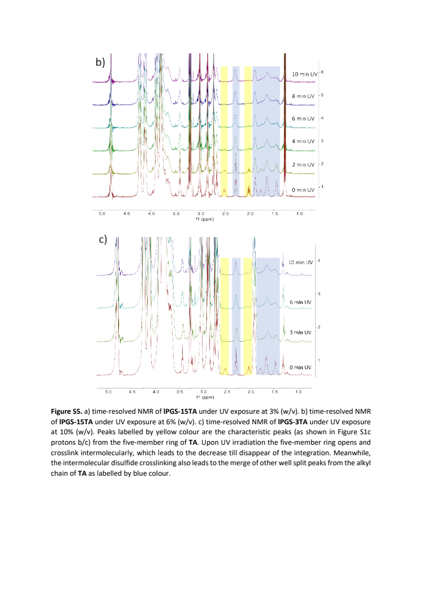
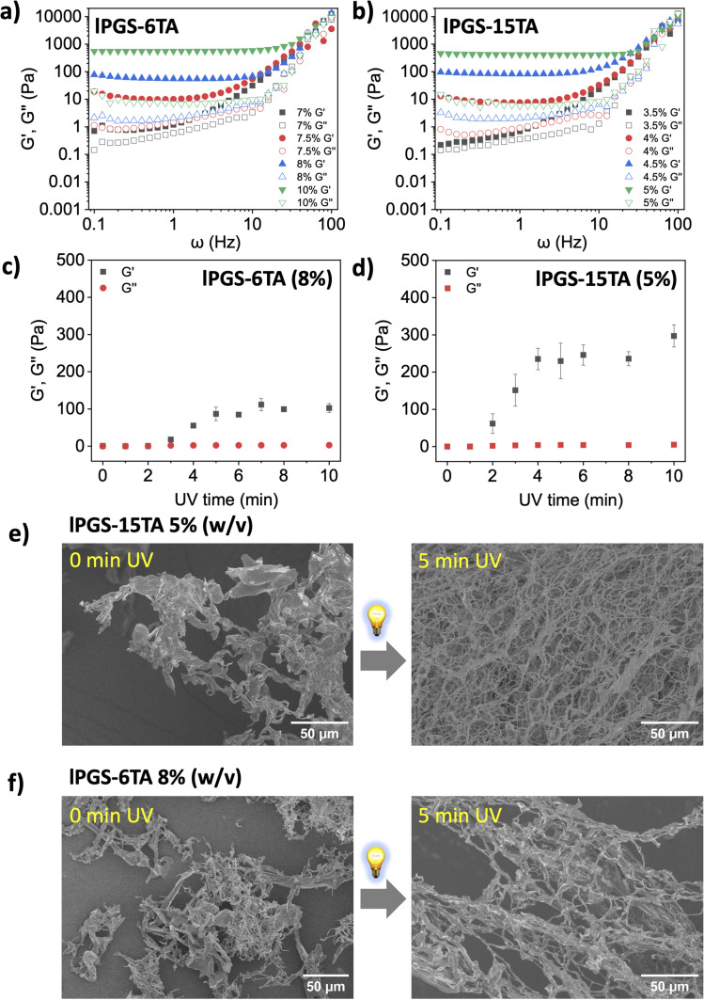
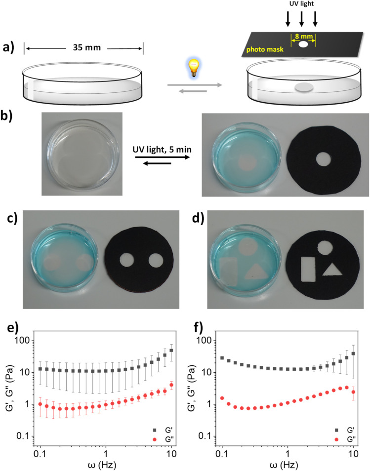
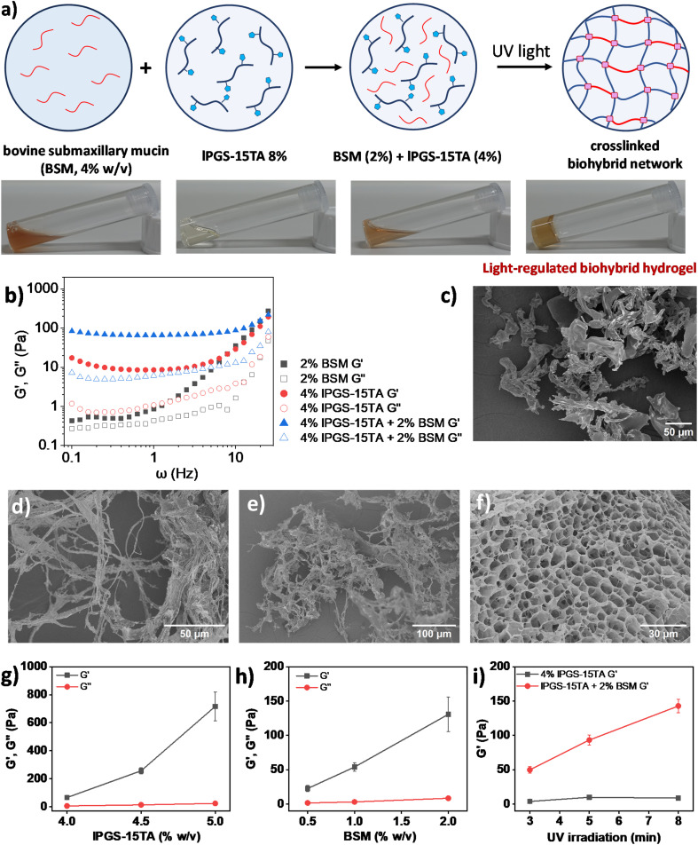
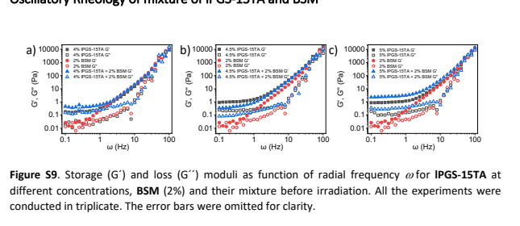
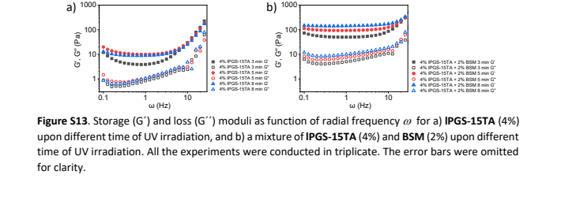

# 从光敏小环到黏液模型：化学变化怎样成为可调凝胶

作者把含光敏二硫戊环的 TA 接到 lPGS，通过化学响应、成胶门槛和流变对照展示可调凝胶，并扩展到局部照射及 BSM 杂化；具体连接机理与天然黏液全部功能仍需分开判断。

Photo-regulated disulfide crosslinking: a versatile approach to construct mucus-inspired hydrogels  
Rui Chen, Krishnendu Das, Jun Feng, Boonya Thongrom, Rainer Haag. Chemical Science, 2025, 16, 5528–5537. DOI: 10.1039/d4sc08284b. 原图 © The Royal Society of Chemistry，CC BY 3.0；导读仅重排解释，原图完整保留，SI 局部附原页。
https://doi.org/10.1039/d4sc08284b

有材料或化学专业基础、第一次阅读本论文的读者

## 为什么要把黏液模型的连接交给光？

天然黏液既含大量水，又能以黏弹性网络构成上皮屏障。研究它的困难不只是拿不到足够样品：不同来源的组成和结构也不统一，提取纯化还可能改变材料。因此，作者想建立一种组成更可控、力学性质可调的模型，用来分开研究结构与性质；本篇首先解决怎样造出这种材料，并未把天然黏液的防御功能直接当成合成材料已实现的功能。〔正文引言；Results P16〕

设计切入口是黏蛋白之间的二硫键。Scheme 1a 画出富半胱氨酸端部的连接，b 则把天然蛋白换成硫酸化线性聚甘油 lPGS，把含 1,2-二硫戊环的硫辛酸（TA）接到链上。骨架提供亲水、多官能和硫酸基特征；有张力的环状二硫键提供光响应连接位点。作者选择的不是复制整套糖蛋白结构，而是把几种与黏液相关的结构特征和可调连接放进同一个构件。〔Scheme 1；Results P5〕

原图完整保留。a 天然黏蛋白；b 合成光敏骨架；c 作者采用的 TA 光交联化学图景。（正文 JATS · Scheme 1（d4sc08284b-s1））

Scheme 1c 是作者采用的光触发开环、链间二硫键连接图景，图中的自由基式及双向箭头属于化学设计解释。它提出了接下来要验证的接力：先确认得到带 TA 的聚合物，再问光照是否改变局部化学，最后才问这些变化是否形成承载应力的整体网络。示意图本身没有测量中间体，也没有给出重复断开—恢复的循环数据。

01·左1 · 动态连接示意等于测过自修复吗？

这里“动态”首先指作者选用的二硫键化学思路。Scheme 1c 的可逆箭头不能替代宏观自修复、可逆光开关或多轮寿命实验；本篇伴读以实际成胶和流变证据为界。

回读依据：正文 Introduction P1–P4；Scheme 1；DOI 10.1039/d4sc08284b

## 把光敏单元接到骨架：先分清合成与交联

作者先由保护的缩水甘油醚单体共聚、脱保护得到线性聚甘油，再硫酸化；保留下来的烯丙基经半胱胺硫醇–烯反应转成带胺的侧基。最后，TA-NHS 活化酯与胺偶联，把光敏环接上去。调节 TA-NHS 的投料当量得到 lPGS-3TA、5TA、6TA、15TA。这里 n 是论文按接枝量命名的材料参数，不应理解成逐条聚合物链都经单分子计数恰好含 n 个单元。〔Fig.1a；SI p3–9〕

SI 不只是路线的重复。Fig. S4 以骨架上邻硫酸基的亚甲基信号作积分参照，利用可归属的 TA 特征质子支持偶联；图注也提醒部分烷基信号与残余溶剂、骨架重叠，不能要求所有积分精确匹配。因而读者可以把接枝系列作为后续比较的材料基础，但不要拿任一重叠峰的高度直接换算每条链的 TA 分布。〔SI p9，Fig.S4 图注〕

一个必须保留的阶段区别是：“无需另加光引发剂或氧化剂”指最终 lPGS-nTA 的光交联成胶。前体 lPGS-NH₂ 的制备在 SI p5 明确加了 65 mg、标作 Irgacure 259 的光引发剂，照光 3 h 后透析；TA 偶联也使用 DMF/水和三乙胺。这项末端交联优势不能扩写成整条制备路线不使用这些化学品，更不自动等于成品生物安全已经验证。

回读依据：正文 Fig.1a，Results P6；SI物理p3–9，Scheme S1、Fig.S1–S4

## 有化学反应，为什么还可能不成胶？

先看 Fig.1b/c 的宏观问题：瓶倾斜后液体还会不会流？在 pH 7.4、10 mM PBS 中，5%（w/v）lPGS-15TA 经 370 nm、25 mW/cm² 光照 5 min 形成自支撑凝胶；10% lPGS-3TA 即使照 60 min 仍是溶液。这里百分数是质量/体积浓度，例如 5% w/v 为每 100 mL 溶液含 5 g 聚合物，并非 TA 占聚合物的质量分数。这组照片的 TA 数、浓度和照射时间同时不同，显示的是各配方条件下的结果，不能用来计算 TA 数的独立因果效应。

a 接枝路线；b 15TA 5%、5 min；c 3TA 10%、60 min；d 系列趋势示意。b/c 同为 370 nm、25 mW/cm²，浓度与时间不同。（正文 JATS · Fig. 1（d4sc08284b-f1））

真正防止误读的是 SI 的阴性成胶对照。Fig. S5a 的 3% lPGS-15TA、b 的 6% lPGS-15TA 在光照后都有 TA 特征谱峰减弱、原来清楚分裂的信号并合；正文报告前者仍流动、后者成胶。c 的 10% lPGS-3TA 也有谱变化，而宏观实验仍不成胶。作者将这些谱变化解释为环打开并发生聚合/交联，将不成胶解释为网络连接不足。局部化学变化与整个样品形成贯通网络并不是同一判据；NMR 也不能独立数清所有链间连接。〔正文 P7；SI p9–10〕

SI 物理 p9 下部局部；3% lPGS-15TA，0–10 min。保留完整原页供回查。（SI PDF 物理 p9 · Fig. S5a）

SI 物理 p10 完整原页；b 为 6%15TA，c 为 10%3TA。c 谱序列至 10 min，不是 60 min。（SI PDF 物理 p10 · Fig. S5b/c）

因此，“不成胶”在这里不是“没有发生光化学变化”的同义词。Table S1 又给出 10% 5TA 照 10 min、8% 6TA 照 5 min 能成胶，支持研究沿接枝量与用量调节的方向推进。但这张表记录的是所测成功/失败配方，不是每个材料的穷尽成胶相图。下一步需要固定照射条件，用力学测量把“看上去不流动”变成可比较的判据。

03·右1 · S5 的黄色、蓝色标区怎样读？

横轴是化学位移 ppm，纵向堆叠的是不同照射时长。黄色标区对应作者归属的环上特征质子，蓝色标区帮助观察其他 TA 烷基信号的分裂变化；这不是成胶百分率或交联密度曲线。S5a 在 SI p9 下部，b/c 在 p10；c 的谱只列 0、3、6、10 min，正文“60 min 仍不成胶”来自另一宏观状态实验，不能把这两条时间线拼为同一谱序列。

回读依据：正文 Fig.1b–d，Results P6–P7；SI物理p9–11，Fig.S5、Table S1

## 用固定条件找成胶门槛，再调模量

振荡流变让样品在小形变下受周期剪切：G′表征储能的弹性响应，G″表征耗散响应。作者先找线性黏弹区，再在 1% 应变下扫频。Fig.2a/b 先回答“同样照光 5 min，需要多少聚合物才出现凝胶式响应”。两轴均为对数，横轴原图写 ω（Hz），这里保留其标法，不擅自换成 rad/s；纵轴为 Pa。实心符号是 G′，对应空心符号是 G″。比较应看同一浓度的成对符号和低频平台，不能只挑高频上扬部分。

a/b 固定 5 min UV 的浓度系列；c/d 固定各自配方的照时系列；e/f 为干燥处理后的 SEM。原图横轴 ω 标作 Hz。（正文 JATS · Fig. 2（d4sc08284b-f2））

在相同 370 nm、25 mW/cm²、5 min 照射下，6TA 从 7% 到 7.5%、15TA 从 3.5% 到 4% 时，G′明显占优，作者据此分别给出约 7.5% 和 4% 的临界成胶浓度 CGC。它是指定照时下的操作性门槛，不是材料脱离实验条件的常数。正文称两者在 CGC、1 Hz 时 G′约 7–10 Pa，G″约 1 Pa，并将其与所引文献的健康气道黏液模量范围联系；这不是本实验同批天然黏液的直接对照，也不表示所有浓度的凝胶都落在该范围。

Fig.2c/d 换了一个问题：各自固定配方后，光照多久能改变弹性？每个时间点来自独立照射的一瓶，再做流变，并非同一瓶原位连续测量。6TA 8% 的 G′约在 3 min 后明显提高，15TA 5% 约在 2 min 起提高，后段增幅趋缓；作者称其趋于饱和，但不宜据此把全部 TA 都判作反应完全。跨 c/d 时 TA 数和聚合物质量浓度同时变化，因此这里比较的是两种配方的响应，不能把模量差全归为单一变量。

Fig.2e/f 最后补上形貌：各自照前与照后，干燥样品由不规则结构转为更明显的纤维/网络状结构，15TA 一组更致密。不过图注称样品经过冻干，SI 方法还列出高真空干燥和镀金。它们与湿态流变互补，不能直接显示水凝胶工作时的孔网，更不能用 SEM 直接识别二硫键。到这里，化学响应、宏观成胶、湿态力学和干态形貌各回答了一层问题，共同支持作者的网络设计解释。

04·左1 · CGC 与最大模量是同一个指标吗？

CGC 问的是固定光照条件下最低到什么浓度出现凝胶式响应；G′则还取决于浓度、照时和测量频率。Fig.2a/b 的阈值组与 c/d 的 8%/5% 配方不能互换；文中更高浓度可得到更强凝胶，并不与阈值附近只有数 Pa 的结果冲突。

回读依据：正文 Fig.2，Results P8–P14；SI物理p2–3、11–13，Fig.S6–S8

## 光还能把凝胶限定在什么位置？

若光只是全瓶开关，其优势还没有发挥完。作者用 35 mm 培养皿装 4% lPGS-15TA，以中央直径 8 mm 的孔控制照射区域。Fig.3a 是装置示意，b–d 才是实际形状结果：照 5 min 后局部留下透明凝胶区，其余仍流动；换掩膜可得到圆形、矩形和三角形区域。亚甲基蓝是在照射后加入，用来帮助看清水相与凝胶区域，不是凭蓝色深浅定量计算交联密度。

a 装置示意；b–d 掩膜与局部凝胶照片；e/f 分别为局部、均匀凝胶流变。染料用于照后辨认区域。（正文 JATS · Fig. 3（d4sc08284b-f3））

形状对了，还要问局部取出的东西是否有凝胶的力学响应。Fig.3e/f 分别展示局部形成和均匀形成样品，横轴按原图为 ω（Hz），纵轴为模量 Pa；黑方块 G′高于红点 G″，给出可比较的凝胶式响应。它把“空间上形成一块东西”接回“这块东西有弹性网络”。这是控制成胶位置的材料展示；天然黏液的空间异质性与防御功能仍不能由几何照片直接替代。

回读依据：正文 Fig.3，Results P15

## 能否让少量天然黏蛋白进入共同成胶？

最后一个转折面向更接近天然组分的模型。作者指出商用牛颌下腺黏蛋白 BSM 在生理 pH 下的成胶能力不足，文献需较高浓度才接近健康痰液的黏弹性；于是尝试让合成聚合物辅助 BSM。先辨清 Fig.4a：最左是 4% BSM 母液，第二幅是 8% lPGS-15TA 母液；混合后标签才是 BSM 2% + 聚合物 4%，第四幅是该混合液光照后的凝胶。前两幅不是最终混合物的两个时间点。〔Fig.4a；正文 P16〕

a 母液→混合→照后；b 照后频率对照；c–f 不同对象/状态的干态 SEM；g/h 两个浓度系列；i 仅 G′随时间。完整图无改动。（正文 JATS · Fig. 4（d4sc08284b-f4））

接着把 Fig.4b 和 SI 的无光对照一起看。Fig.S9a 显示 4% 聚合物、2% BSM 及其混合液照前都具有低模量，单纯混合没有带来照后那样的弹性平台；b/c 又补充 4.5% 和 5% 聚合物的照前对照。Fig.4b 则比较照光 5 min 后的三组，混合物低频 G′明显高于两种单组分。共享光照和流变条件的这组差异支持作者所说的两组分共同参与成胶，避免把“添加 BSM”与“无需光照就增稠”混成一回事。

SI 物理 p13 上部局部；a/b/c 分别使用 4%/4.5%/5% 聚合物，BSM 为 2%；全部为照前。三次重复，原图省略误差棒。（SI PDF 物理 p13 · Fig. S9a–c）

Fig.4c–f 不是同一样品的四帧电影：c 是无光 4% 聚合物，d 是无光 2% BSM，e 是无光混合物，f 才是照后混合物，且标尺不同。照后多孔形貌与模量增强相互呼应。作者进一步解释为 BSM 的硫醇参与光调二硫键连接；本读本把它保留为有多项证据支持的作者解释，干态 SEM 和总体流变本身并未直接鉴定每一种 BSM–聚合物共价连接，也不独立排除全部物理相互作用。

调节实验又提供两条检验。Fig.4g 固定 BSM 2%，将聚合物从 4% 提高到 4.5%、5%；h 固定聚合物 4%，将 BSM 从 0.5% 提高到 1%、2%。两组都显示 G′增加，h 中 G″变化较小；它们是两个独立浓度系列，纵轴量程也不同，不能直接比较图上斜率。

其后 Fig.4i 固定各自配方比较照时：混合组 G′随 3、5、8 min 显著提高，4% 聚合物单独变化较小，进一步支持 BSM 参与网络形成的作者解释。

这里有一个容易被集合图注掩盖的指标区别：Fig.4i 实际只画 G′，黑方块对应聚合物，红点对应混合体系；它没有 G″曲线，不能据此写 G″随时间不变。若要同时看两种模量，应读 SI p14 的 Fig.S13a/b：同样的 3、5、8 min，以实心/空心符号区分 G′/G″，给出完整频率依赖。SI 因而既补足无光对照，也补足时间比较的指标，而不是装饰性附件。

06·右1 · S13 怎样补足 Fig.4i？

先比较 a 中聚合物单独的各照时曲线，再看 b 中固定 2% BSM 的混合物；横轴是 ω（Hz），纵轴为 Pa。黑、红、蓝分别是 3、5、8 min，同一颜色的实心与空心配成两模量。Fig.4i 只是从这些频率数据抽取 1 Hz 的 G′。完整曲线可避免把一个频率点误读为全频段恒定，或把不同体系的照时图例混用。

SI 物理 p14 下部局部；a 4%聚合物，b 4%聚合物+2%BSM；各照3/5/8 min，实心G′/空心G″。（SI PDF 物理 p14 · Fig. S13a/b）

回读依据：正文 Fig.4，Results P16–P18；SI物理p13–14，Fig.S9–S13

## 这项工作把模型推进到了哪一步？

这篇论文的贡献可以落在一条有限、可检查的链上：把光响应 TA 接到 lPGS，使光照后的局部化学变化能够在合适配方中转化为成胶；在指定测试条件下以接枝量、浓度和光照时间调节模量；再把这种控制延伸到掩膜限定位置和 BSM 杂化体系。未成胶但有谱变化的样品，是这条链的重要边界，而不是应当删去的失败。

因此，“黏液启发”最可靠的含义是若干结构特征、二硫键交联思路及所测黏弹性被纳入同一平台。作者对生物模型和其他大分子材料的设想值得后续检验；抗病原能力、活细胞条件下的光照兼容性、长期稳定与多轮恢复能力仍需要各自的实验，不能由一个接近天然范围的 G′值推出。下一轮精读可围绕实际目标先查原始流变数据及样品重复，再设计湿态结构、连接特异性和生物功能测试。

回读依据：正文 Results P19、Conclusion；全文 Fig.1–4；SI方法与Fig.S5、S9、S13

## 与画布一致的阅读导航

- [01 · 为什么要把黏液模型的连接交给光？](#question)
- [02 · 把光敏单元接到骨架：先分清合成与交联](#building)
- [03 · 有化学反应，为什么还可能不成胶？](#threshold)
- [04 · 用固定条件找成胶门槛，再调模量](#mechanics)
- [05 · 光还能把凝胶限定在什么位置？](#space)
- [06 · 能否让少量天然黏蛋白进入共同成胶？](#hybrid)
- [07 · 这项工作把模型推进到了哪一步？](#limits)
- [01·左1 · 动态连接示意等于测过自修复吗？](#branch-question-1)
- [03·右1 · S5 的黄色、蓝色标区怎样读？](#branch-threshold-1)
- [04·左1 · CGC 与最大模量是同一个指标吗？](#branch-mechanics-1)
- [06·右1 · S13 怎样补足 Fig.4i？](#branch-hybrid-1)

## 研究论证关系

- [谱变化与成胶分开](#threshold-p2) → 为光敏化学设计提供支持 → [以连接方式建立模型](#question-p2)（证据/比较关系）
- [固定照时找门槛](#mechanics-p2) → 为成胶目标提供湿态证据 → [以连接方式建立模型](#question-p2)（证据/比较关系）
- [固定照时找门槛](#mechanics-p2) → 继续检验固定配方的光时响应 → [配方内光调模量](#mechanics-p3)（解释/研究推进）
- [以连接方式建立模型](#question-p2) → 提出与 BSM 共同连接的解释 → [支持两组分参与成胶](#hybrid-p2)（解释/研究推进）
- [局部照射局部成胶](#space-p1) → 提供位置控制的实测范围 → [模型能力仍有边界](#limits-p2)（证据/比较关系）
- [支持两组分参与成胶](#hybrid-p2) → 提供杂化成胶范围并保留键型边界 → [模型能力仍有边界](#limits-p2)（解释/研究推进）
- [配方内光调模量](#mechanics-p3) → 提供模量可调的测量范围 → [模型能力仍有边界](#limits-p2)（证据/比较关系）

## 本地原始材料

- [正文 JATS/XML，DOI 10.1039/d4sc08284b；按小节、科学段落及原图锚点定位，非 PDF 页码。](sources/aa7fbf9234fc76dda718.xml)
- [同篇 Supporting Information，共15个PDF物理页；引用页码均为物理页。](sources/ec4b2ac862a70573c4a2.pdf)

## 覆盖范围

已读正文科学段落、图注及 SI 15 页可提取文字；实际看过 Scheme 1、Fig.1–4，以及 SI 物理 p5、p9、p10、p13、p14 原页。主线解释光敏接枝、反应/成胶区别、流变、局部成胶、BSM 杂化；其余合成谱图未逐峰独立复算，不声称完整复现或独立验证原始实验。
