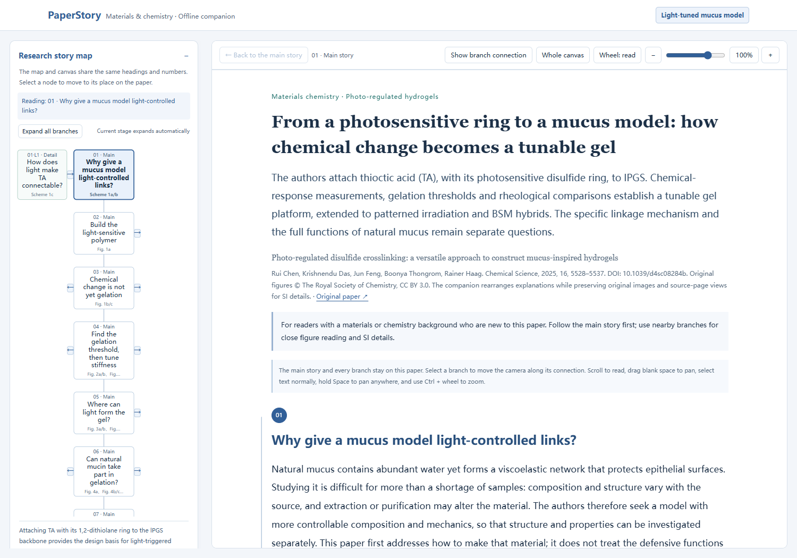
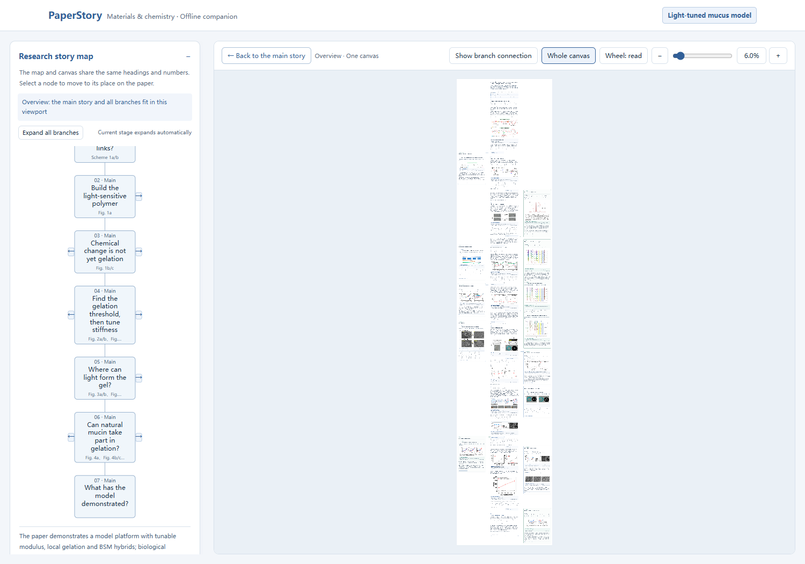
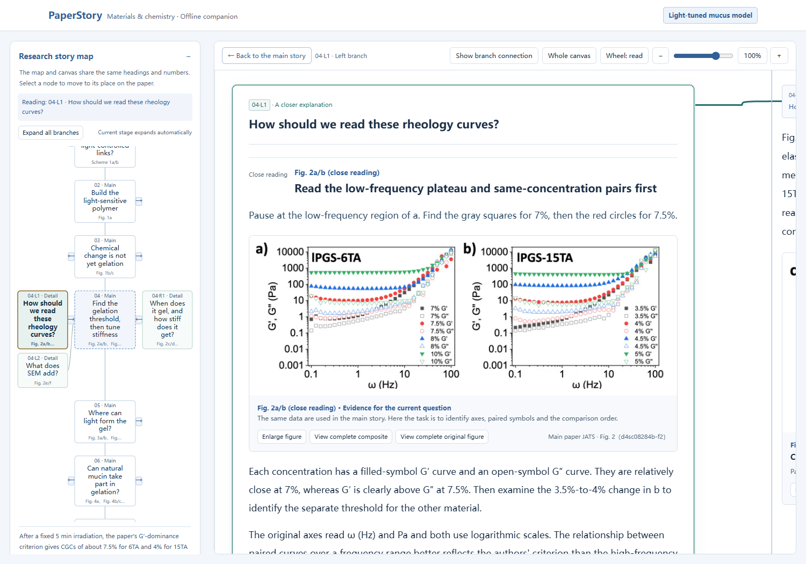
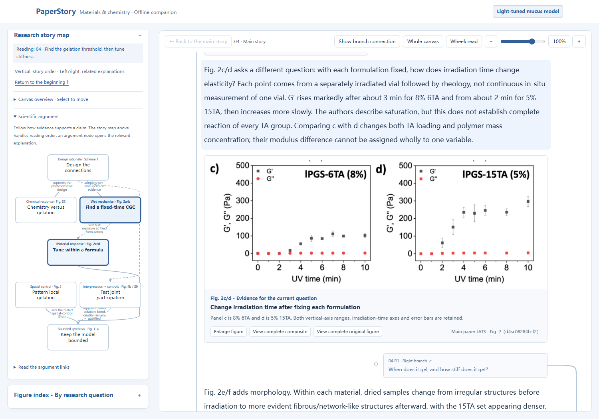
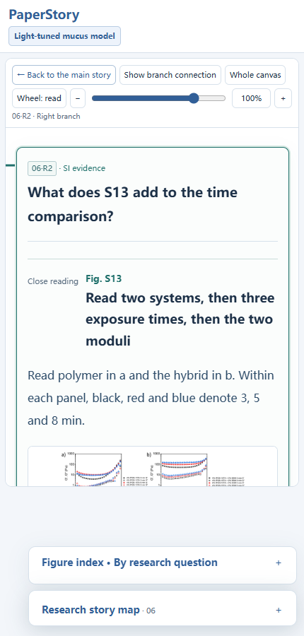

# The English reading experience

[Open the English companion](https://xuehb5.github.io/paper-story-reader/demo-en/A.html?v=0.21.0) · [English installation](../README.en.md)

These are actual browser screenshots from the shipped renderer, not interface mockups. The complete story uses the same main article, matching SI and hash-identical original images as the Chinese example. They demonstrate the worked interface, not measured reading gains.

## Follow the research story

The main prose explains why the work was needed, the design, tests, observations and bounded conclusions. The map and canvas share stage titles and numbering.

## Keep the whole paper on one canvas

All branches stay beside the trunk. “Whole canvas” shows their spatial relationships; selecting a map node moves the camera back to reading size rather than opening another page.

## Read a difficult figure where it advances the argument

A nearby rheology branch identifies sample concentration, filled/open symbols and the relevant low-frequency comparison, then returns to the gelation question. Full original composites and source pages remain available.

## Inspect the scientific argument

The argument graph separates actual support, interpretation, next questions and scope from mere reading order. Select a node to inspect the paragraph that explains the judgment.

## Continue on a narrow screen

English controls and branches retain the same canvas. Here the SI branch restores a main-text single-point modulus comparison to the complete frequency curves.

Original paper, SI and figures retain CC BY 3.0 and attribution. [Source and adaptation scope](../examples/hydrogel-en/README.md).
