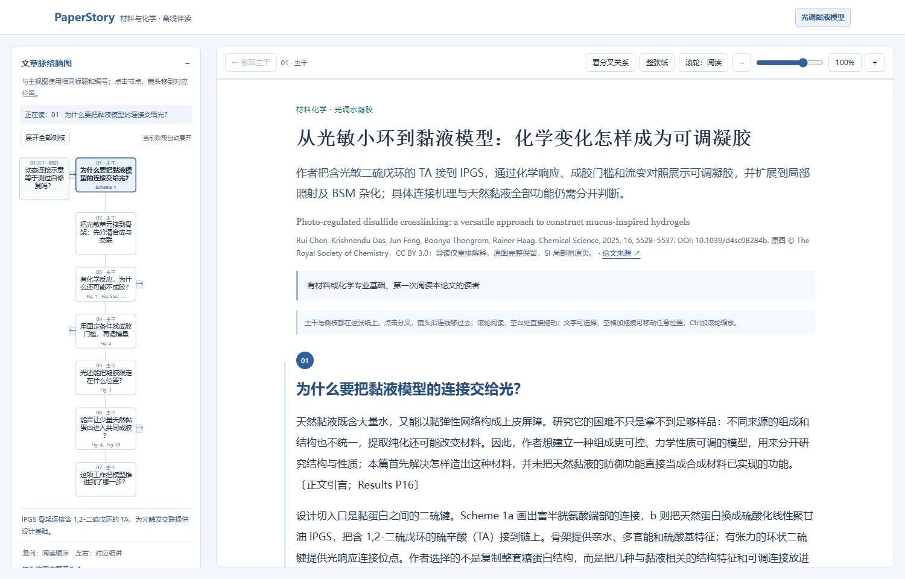
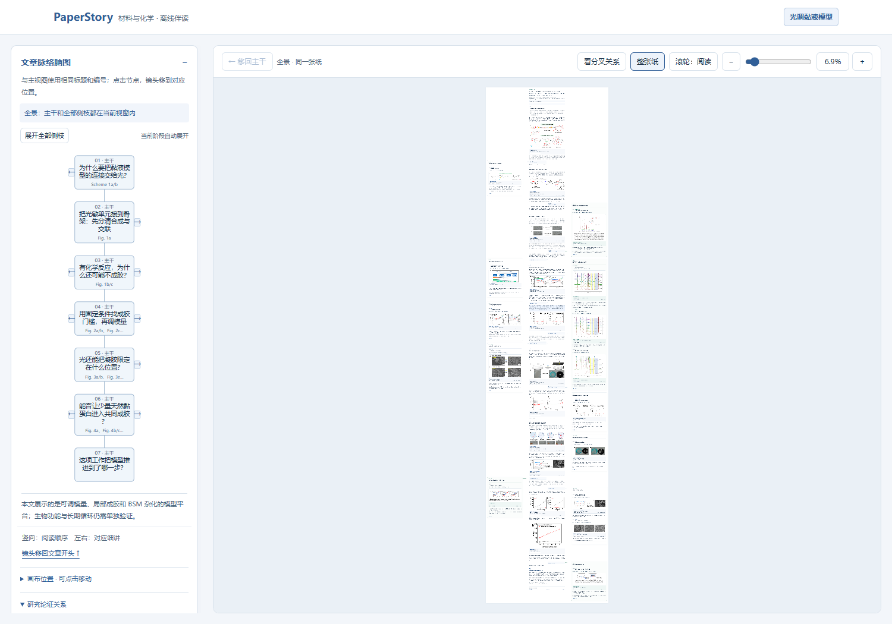
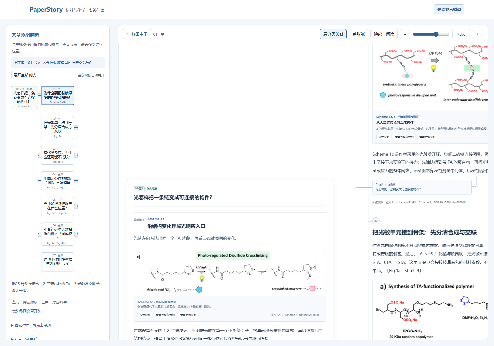
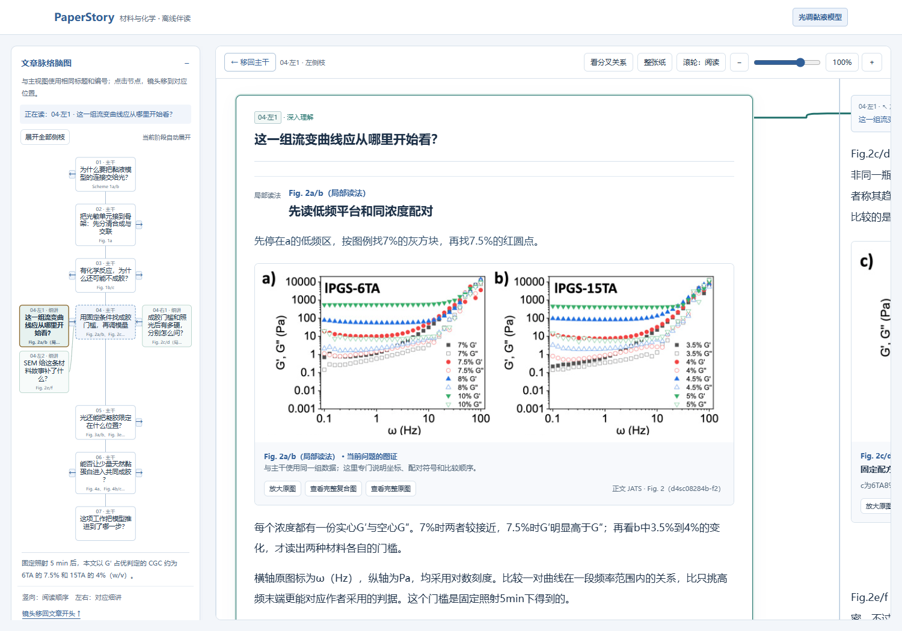
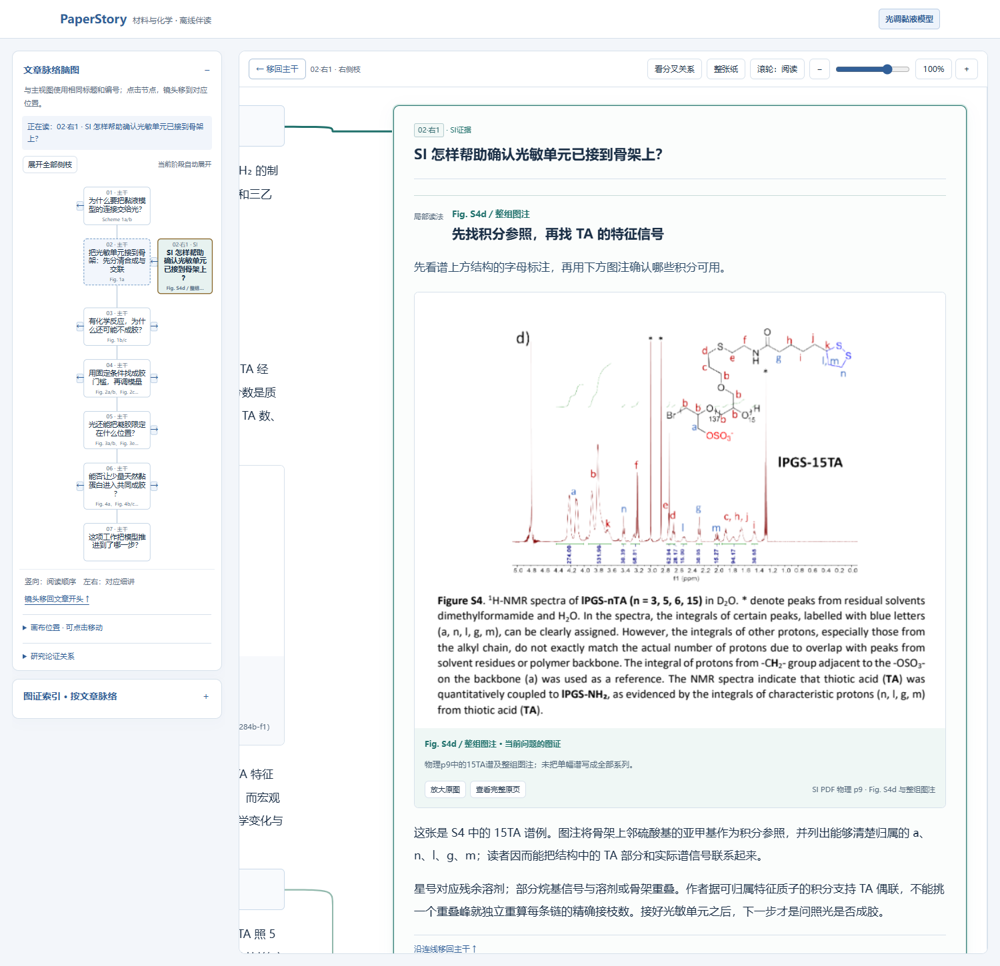
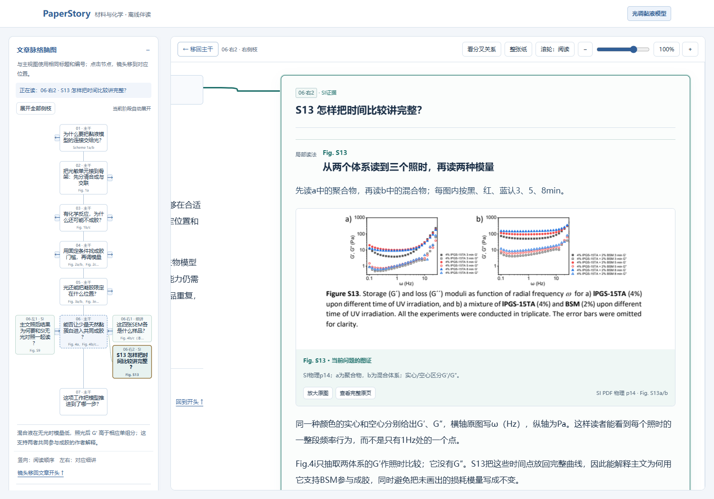
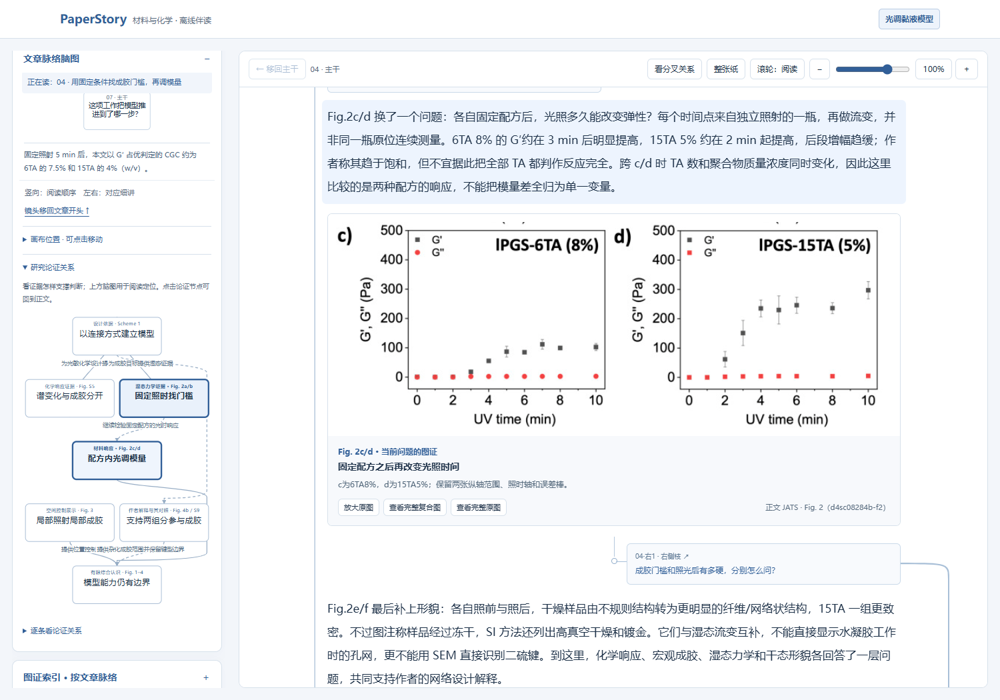
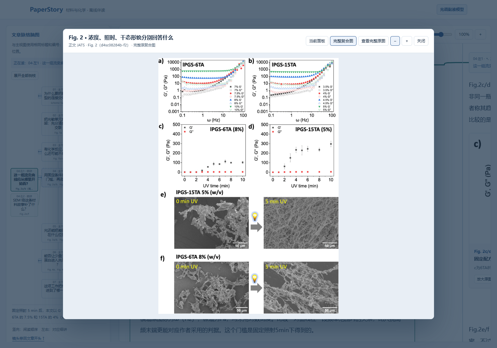

# 从故事主干，到图证与SI：真实使用截图

[返回项目首页](../README.md) · [打开交互演示](https://xuehb5.github.io/paper-story-reader/demo/A.html?v=0.20.2)

这些截图来自PaperStory v0.20.2随包生成器的实际读本，未用设计稿或模拟界面替代成品。均为同一篇光调二硫键水凝胶论文及其SI。截图记录具体界面状态，不能替代对其他论文、模型或读者理解效果的检验。

## 1. 先沿主干理解研究的来龙去脉

从“为什么要把黏液模型的连接交给光”进入，接着读构件设计与制备、化学响应、成胶门槛、可调力学、空间控制和BSM杂化。左侧脑图与正文共享标题、编号和相关图号。

## 2. 整张纸上的主干、侧枝和连接

点击“整张纸”可以看到完整树状正文。这里为全景比例，细读时点脑图节点或恢复100%；[打开高分辨率完整画布长图](images/whole-canvas.png)，可放大查看全部主干与左右侧枝。长图由真实浏览器增大视窗后截取整张纸面，未拼接或替换内容。

在设计阶段的侧枝点击“看分叉关系”，同一视窗会展示主干与对应细讲的空间联系。点击侧枝后镜头连续移近；正文和其他侧枝仍留在同一画布，读完可以返回原位置。这个状态为观察关系适当缩小了画布，细读时可恢复阅读比例。

## 3. 复杂图有具体的阅读顺序

在“这一组流变曲线应从哪里开始看”侧枝中，先辨认同一浓度的G′/G″配对，再比较低频平台与成胶门槛。图像与解释相邻，侧枝回答当前科学问题，再把读者带回主线。

## 4. SI帮助讲清构件的身份

主文讲TA怎样接到lPGS上；对应侧枝查看SI中的结构标注和NMR谱例，解释积分参照、可归属信号和峰重叠的影响。主文与SI在同一个理解任务下合读。

## 5. SI补齐主文单点比较的信息

主文Fig.4i提取1Hz处的G′作时间比较，SI的Fig.S13提供完整频率曲线和两种模量。侧枝先认两个体系，再看照时和符号，让读者知道它补充了主线的哪一部分。

## 6. 阅读顺序与研究论证关系分别表达

阅读脑图帮助按故事定位；“研究论证关系”表达哪些观察提供支持、哪些关系属于解释或范围边界。点击论证节点，回到承载解释的正文段落。

## 7. 随时把局部放回完整原图

从局部流变图打开“完整复合图”，可一起核对坐标、图例、其他面板与样品身份。图片窗口保留放大、缩小、关闭，以及完整原图或SI原页入口。

截图中的论文、SI及原图保留原始CC BY 3.0许可。论文署名与来源见读本；完整说明见[第三方许可](../THIRD_PARTY_NOTICES.md)。
